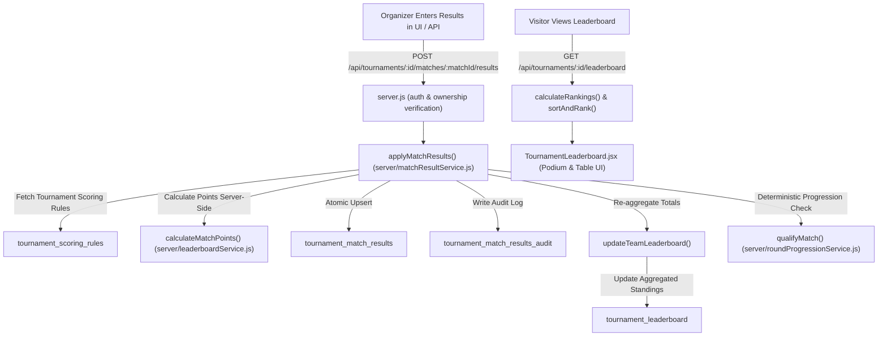

# Comprehensive Audit: Tournament Roadmap & Leaderboard System

**Date:** October 2026  
**Target Repository:** Match District Esports Platform (`e:\Projects\MatchDistrict`)  
**Scope:** Complete architectural, database, authorization, code, and security audit of the tournament roadmap, scheduling, team slotting, qualification, and leaderboard systems.  
**Constraint:** Strict audit mode — zero application code changes made.

---

## 1. Database Architecture (Supabase / PostgreSQL)

### 1.1 Architectural Split & The Dual-Schema Hazard
A fundamental finding of this audit is that **the database operates under a dual-schema divergence**:
1. **The Legacy / Client Schema (`schema.sql`)**: Contains UUID primary keys (`tournaments.id UUID`, `registrations.id UUID`), relies on Supabase Auth (`auth.users`), defines triggers (`fn_sync_tournament_slots`, `fn_enforce_tournament_plan_limits`), and contains Row Level Security (RLS) policies.
2. **The Active Live Schema (`server.js` `initDb()`)**: The Node.js application server connects directly to the Supabase Postgres instance using `pg.Pool` with superuser/service credentials specified in `DATABASE_URL`. It created the live tables using `VARCHAR(50)` IDs (`tournaments.id VARCHAR(50)`, `tournament_registrations`, `tournament_rounds`, `tournament_days`, `tournament_groups`, `tournament_rooms`, `tournament_matches`, `tournament_teams`, `tournament_match_results`, `tournament_leaderboard`).

> [!CAUTION]
> In the live Supabase database, `schema.sql` is **not** the active schema. Tables like `registrations` do not exist; instead, `tournament_registrations` is used. Furthermore, `fn_sync_tournament_slots` and `fn_enforce_tournament_plan_limits` are **not installed** in the active database.

---

### 1.2 Table & Column Catalog

Below is the verified schema of every table related to tournaments, slots, registrations, teams, rounds, roadmap, leaderboard, and scoring:

#### A. Core Tournaments Table (`tournaments`) — 74 Columns
*Defined in `server.js:468–540` and migrated incrementally:*
```sql
CREATE TABLE IF NOT EXISTS tournaments (
  id VARCHAR(50) PRIMARY KEY,
  title VARCHAR(255),
  game VARCHAR(255),
  status VARCHAR(50),
  "badgeBg" VARCHAR(100),
  "badgeText" VARCHAR(100),
  date VARCHAR(100),
  prize VARCHAR(100),
  entry VARCHAR(100),
  "teamsCount" VARCHAR(100),
  featured BOOLEAN DEFAULT false,
  "orgName" VARCHAR(255),
  "registrationOpenDate" VARCHAR(100),
  "registrationCloseDate" VARCHAR(100),
  "startDate" VARCHAR(100),
  created_at TIMESTAMP DEFAULT CURRENT_TIMESTAMP,
  rules TEXT,
  chat TEXT,
  notices TEXT,
  teams TEXT,
  region VARCHAR(100),
  format VARCHAR(100),
  "slotsTotal" INTEGER DEFAULT 100,
  "slotsFilled" INTEGER DEFAULT 0,
  "roomID" VARCHAR(100),
  "roomPassword" VARCHAR(100),
  timeline TEXT,
  "bannerUrl" TEXT,
  "logoUrl" TEXT,
  "isDraft" BOOLEAN DEFAULT false,
  version INTEGER DEFAULT 1,
  "orgId" VARCHAR(50),
  match_type VARCHAR(20) DEFAULT 'squad',
  perspective VARCHAR(10) DEFAULT 'tpp',
  reserved_slots INTEGER DEFAULT 0,
  entry_fee_amount INTEGER DEFAULT 0,
  prize_pool_type VARCHAR(20) DEFAULT 'fixed',
  prize_pool_amount INTEGER DEFAULT 0,
  prize_split_1st VARCHAR(50) DEFAULT '',
  prize_split_2nd VARCHAR(50) DEFAULT '',
  prize_split_3rd VARCHAR(50) DEFAULT '',
  prize_split_mvp VARCHAR(50) DEFAULT '',
  description TEXT DEFAULT '',
  cover_image_url TEXT DEFAULT '',
  lobby_start_time VARCHAR(100) DEFAULT '',
  sponsors_data TEXT DEFAULT '[]',
  roadmap_status VARCHAR(50) DEFAULT 'pending',
  finalized_at TIMESTAMPTZ,
  finalized_by VARCHAR(50),
  sponsors_enabled BOOLEAN DEFAULT false,
  mvp_enabled BOOLEAN DEFAULT false,
  mvp_amount INTEGER DEFAULT 0,
  kill_reward_enabled BOOLEAN DEFAULT false,
  kill_reward_per_kill INTEGER DEFAULT 0,
  prize_positions TEXT DEFAULT '[]',
  "orgLogo" TEXT DEFAULT '',
  "orgHandle" VARCHAR(100) DEFAULT '',
  "orgMotto" VARCHAR(255) DEFAULT '',
  max_slots_per_room INTEGER DEFAULT NULL,
  teams_per_match INTEGER DEFAULT 20,
  unique_amount_suffix_enabled BOOLEAN DEFAULT false,
  card_color VARCHAR(50) DEFAULT 'white',
  rounds_published BOOLEAN DEFAULT true,
  teams_per_group INTEGER DEFAULT 16,
  roadmap_image_url TEXT DEFAULT '',
  room_credentials_release_minutes INTEGER DEFAULT 15,
  matches_per_day INTEGER,
  first_match_time VARCHAR(10),
  match_gap_minutes INTEGER,
  match_duration_minutes INTEGER,
  teams_advancing_per_district INTEGER,
  enable_semi_finals BOOLEAN
);
```

#### B. Registrations & Slot Grid
*Defined in `server.js:549–605, 847–860`:*
```sql
CREATE TABLE IF NOT EXISTS tournament_registrations (
  id VARCHAR(50) PRIMARY KEY,
  tournament_id VARCHAR(50) NOT NULL,
  user_id VARCHAR(50) NOT NULL,
  team_name VARCHAR(255) NOT NULL,
  captain VARCHAR(255) NOT NULL,
  captain_uid VARCHAR(100),
  members TEXT DEFAULT '[]',
  status VARCHAR(50) DEFAULT 'pending',
  slot_number INTEGER,
  transaction_id VARCHAR(100),
  payment_app VARCHAR(50),
  screenshot_url TEXT,
  email VARCHAR(255),
  phone VARCHAR(20),
  rejected_at TIMESTAMP,
  idempotency_key VARCHAR(100),
  version INTEGER DEFAULT 1,
  group_id VARCHAR(50),
  group_name VARCHAR(50),
  created_at TIMESTAMP DEFAULT CURRENT_TIMESTAMP,
  updated_at TIMESTAMP DEFAULT CURRENT_TIMESTAMP
);

CREATE TABLE IF NOT EXISTS tournament_registration_groups (
  id VARCHAR(50) PRIMARY KEY,
  tournament_id VARCHAR(50) NOT NULL,
  group_index INTEGER NOT NULL,
  name VARCHAR(5) NOT NULL,
  capacity INTEGER NOT NULL DEFAULT 16,
  created_at TIMESTAMP DEFAULT CURRENT_TIMESTAMP,
  updated_at TIMESTAMP DEFAULT CURRENT_TIMESTAMP
);

CREATE TABLE IF NOT EXISTS slot_grid (
  id VARCHAR(50) PRIMARY KEY,
  tournament_id VARCHAR(50) NOT NULL,
  room_index INTEGER NOT NULL,
  slot_index INTEGER NOT NULL,
  status VARCHAR(20) DEFAULT 'empty',
  registration_id VARCHAR(50),
  created_at TIMESTAMP DEFAULT CURRENT_TIMESTAMP
);
```

#### C. Tournament Teams & Members
*Defined in `server.js:1146–1205`:*
```sql
CREATE TABLE IF NOT EXISTS tournament_teams (
  id VARCHAR(50) PRIMARY KEY,
  tournament_id VARCHAR(50) NOT NULL REFERENCES tournaments(id) ON DELETE CASCADE,
  team_name VARCHAR(255) NOT NULL,
  leader_user_id VARCHAR(50) NOT NULL REFERENCES users(id) ON DELETE CASCADE,
  status VARCHAR(50) DEFAULT 'awaiting_members',
  registration_id VARCHAR(50),
  created_at TIMESTAMPTZ DEFAULT NOW(),
  updated_at TIMESTAMPTZ DEFAULT NOW(),
  UNIQUE(tournament_id, team_name)
);

CREATE TABLE IF NOT EXISTS tournament_team_members (
  id VARCHAR(50) PRIMARY KEY,
  tournament_team_id VARCHAR(50) NOT NULL REFERENCES tournament_teams(id) ON DELETE CASCADE,
  tournament_id VARCHAR(50) NOT NULL REFERENCES tournaments(id) ON DELETE CASCADE,
  user_id VARCHAR(50) NOT NULL REFERENCES users(id) ON DELETE CASCADE,
  role VARCHAR(20) NOT NULL,
  status VARCHAR(20) DEFAULT 'active',
  joined_at TIMESTAMPTZ DEFAULT NOW(),
  UNIQUE(tournament_id, user_id)
);

CREATE TABLE IF NOT EXISTS tournament_team_invitations (
  id VARCHAR(50) PRIMARY KEY,
  tournament_id VARCHAR(50) NOT NULL REFERENCES tournaments(id) ON DELETE CASCADE,
  tournament_team_id VARCHAR(50) NOT NULL REFERENCES tournament_teams(id) ON DELETE CASCADE,
  created_by_user_id VARCHAR(50) NOT NULL REFERENCES users(id) ON DELETE CASCADE,
  token VARCHAR(100) UNIQUE NOT NULL,
  status VARCHAR(20) DEFAULT 'active',
  expires_at TIMESTAMPTZ NOT NULL,
  created_at TIMESTAMPTZ DEFAULT NOW(),
  updated_at TIMESTAMPTZ DEFAULT NOW()
);
```

#### D. Roadmap Hierarchy: Rounds, Days, Groups, Rooms, Matches & Assignments
*Defined in `server.js:961–1085, 1216–1238`:*
```sql
CREATE TABLE IF NOT EXISTS tournament_rounds (
  id VARCHAR(50) PRIMARY KEY,
  tournament_id VARCHAR(50) NOT NULL REFERENCES tournaments(id) ON DELETE CASCADE,
  round_number INTEGER NOT NULL,
  name VARCHAR(255) NOT NULL,
  status VARCHAR(30) DEFAULT 'configured',
  teams_advancing INTEGER,
  date VARCHAR(30),
  time VARCHAR(10),
  map VARCHAR(255),
  round_type VARCHAR(50) DEFAULT 'qualifier',
  advancement_type VARCHAR(50) DEFAULT 'per_district',
  advancement_target_round_id VARCHAR(50),
  teams_advancing_per_district INTEGER,
  teams_advancing_per_match INTEGER,
  round_order INTEGER,
  created_at TIMESTAMPTZ DEFAULT NOW(),
  updated_at TIMESTAMPTZ DEFAULT NOW(),
  UNIQUE(tournament_id, round_number)
);

CREATE TABLE IF NOT EXISTS tournament_days (
  id VARCHAR(50) PRIMARY KEY,
  tournament_id VARCHAR(50) NOT NULL REFERENCES tournaments(id) ON DELETE CASCADE,
  round_id VARCHAR(50) REFERENCES tournament_rounds(id) ON DELETE CASCADE,
  day_number INTEGER NOT NULL,
  date VARCHAR(30) NOT NULL,
  UNIQUE(tournament_id, round_id, day_number)
);

CREATE TABLE IF NOT EXISTS tournament_groups (
  id VARCHAR(50) PRIMARY KEY,
  day_id VARCHAR(50) NOT NULL REFERENCES tournament_days(id) ON DELETE CASCADE,
  tournament_id VARCHAR(50) NOT NULL REFERENCES tournaments(id) ON DELETE CASCADE,
  round_id VARCHAR(50) REFERENCES tournament_rounds(id) ON DELETE CASCADE,
  group_name VARCHAR(100) NOT NULL,
  sequence INTEGER NOT NULL,
  display_order INTEGER,
  district_id VARCHAR(50),
  UNIQUE(day_id, sequence)
);

CREATE TABLE IF NOT EXISTS tournament_rooms (
  id VARCHAR(50) PRIMARY KEY,
  group_id VARCHAR(50) NOT NULL REFERENCES tournament_groups(id) ON DELETE CASCADE,
  day_id VARCHAR(50) NOT NULL REFERENCES tournament_days(id) ON DELETE CASCADE,
  tournament_id VARCHAR(50) NOT NULL REFERENCES tournaments(id) ON DELETE CASCADE,
  round_id VARCHAR(50) REFERENCES tournament_rounds(id) ON DELETE CASCADE,
  room_number INTEGER NOT NULL,
  capacity INTEGER NOT NULL,
  status VARCHAR(30) DEFAULT 'DRAFT'
);

CREATE TABLE IF NOT EXISTS tournament_matches (
  id VARCHAR(50) PRIMARY KEY,
  tournament_id VARCHAR(50) NOT NULL REFERENCES tournaments(id) ON DELETE CASCADE,
  round_id VARCHAR(50) REFERENCES tournament_rounds(id) ON DELETE CASCADE,
  day_id VARCHAR(50) REFERENCES tournament_days(id) ON DELETE CASCADE,
  group_id VARCHAR(50) REFERENCES tournament_groups(id) ON DELETE CASCADE,
  room_id VARCHAR(50) REFERENCES tournament_rooms(id) ON DELETE CASCADE,
  match_number INTEGER NOT NULL,
  start_time VARCHAR(10) NOT NULL,
  end_time VARCHAR(10) NOT NULL,
  status VARCHAR(30) DEFAULT 'PENDING',
  room_identifier VARCHAR(100),
  room_password VARCHAR(100),
  credential_status VARCHAR(30) DEFAULT 'Not Configured',
  map VARCHAR(100),
  group_name VARCHAR(100),
  id_pwd_release_time VARCHAR(50),
  next_match_id VARCHAR(50) REFERENCES tournament_matches(id) ON DELETE SET NULL,
  next_round_id VARCHAR(50) REFERENCES tournament_rounds(id) ON DELETE SET NULL,
  teams_advancing INTEGER,
  progression_processed BOOLEAN DEFAULT false,
  origin VARCHAR(20) DEFAULT 'automatic',
  manual_override BOOLEAN DEFAULT FALSE,
  notes TEXT,
  display_order INTEGER,
  CONSTRAINT uq_tournament_matches_round_match UNIQUE NULLS NOT DISTINCT (tournament_id, round_id, match_number)
);

CREATE TABLE IF NOT EXISTS tournament_match_assignments (
  id VARCHAR(50) PRIMARY KEY,
  tournament_id VARCHAR(50) NOT NULL REFERENCES tournaments(id) ON DELETE CASCADE,
  tournament_team_id VARCHAR(50) NOT NULL REFERENCES tournament_teams(id) ON DELETE CASCADE,
  match_id VARCHAR(50) NOT NULL REFERENCES tournament_matches(id) ON DELETE CASCADE,
  room_id VARCHAR(50) REFERENCES tournament_rooms(id) ON DELETE CASCADE,
  group_id VARCHAR(50) REFERENCES tournament_groups(id) ON DELETE CASCADE,
  day_id VARCHAR(50) REFERENCES tournament_days(id) ON DELETE CASCADE,
  status VARCHAR(20) DEFAULT 'allocated',
  source VARCHAR(20) DEFAULT 'manual',
  assigned_at TIMESTAMPTZ DEFAULT NOW(),
  UNIQUE(tournament_team_id, match_id)
);
```

#### E. Scoring, Results, Leaderboard & Standings
*Defined in `server.js:1252–1341`:*
```sql
CREATE TABLE IF NOT EXISTS tournament_scoring_rules (
  tournament_id VARCHAR(50) PRIMARY KEY REFERENCES tournaments(id) ON DELETE CASCADE,
  kill_points_multiplier INTEGER DEFAULT 1,
  placement_points_map JSONB DEFAULT '{"1": 15, "2": 12, "3": 10, "4": 8, "5": 6, "6": 4, "7": 2, "8": 1, "9": 1, "10": 1, "11": 1, "12": 1, "13": 0, "14": 0, "15": 0, "16": 0, "17": 0, "18": 0, "19": 0, "20": 0}'::jsonb,
  wwcd_bonus INTEGER DEFAULT 0,
  updated_at TIMESTAMPTZ DEFAULT NOW()
);

CREATE TABLE IF NOT EXISTS tournament_match_results (
  id VARCHAR(50) PRIMARY KEY,
  tournament_id VARCHAR(50) NOT NULL REFERENCES tournaments(id) ON DELETE CASCADE,
  match_id VARCHAR(50) NOT NULL REFERENCES tournament_matches(id) ON DELETE CASCADE,
  team_id VARCHAR(50) NOT NULL REFERENCES tournament_teams(id) ON DELETE CASCADE,
  placement INTEGER NOT NULL,
  kills INTEGER NOT NULL,
  kill_points INTEGER DEFAULT 0,
  placement_points INTEGER DEFAULT 0,
  wwcd BOOLEAN DEFAULT FALSE,
  total_points INTEGER DEFAULT 0,
  status VARCHAR(20) DEFAULT 'pending',
  submitted_by VARCHAR(50),
  verified_by VARCHAR(50),
  created_at TIMESTAMPTZ DEFAULT NOW(),
  updated_at TIMESTAMPTZ DEFAULT NOW(),
  UNIQUE(match_id, team_id)
);

CREATE TABLE IF NOT EXISTS tournament_match_results_audit (
  id VARCHAR(50) PRIMARY KEY,
  result_id VARCHAR(50) NOT NULL REFERENCES tournament_match_results(id) ON DELETE CASCADE,
  action VARCHAR(50) NOT NULL,
  previous_data JSONB,
  new_data JSONB,
  actor_id VARCHAR(50),
  reason TEXT,
  timestamp TIMESTAMPTZ DEFAULT NOW()
);

CREATE TABLE IF NOT EXISTS tournament_leaderboard (
  id VARCHAR(50) PRIMARY KEY,
  tournament_id VARCHAR(50) NOT NULL REFERENCES tournaments(id) ON DELETE CASCADE,
  team_id VARCHAR(50) NOT NULL REFERENCES tournament_teams(id) ON DELETE CASCADE,
  matches_played INTEGER DEFAULT 0,
  total_kills INTEGER DEFAULT 0,
  total_kill_points INTEGER DEFAULT 0,
  total_placement_points INTEGER DEFAULT 0,
  total_points INTEGER DEFAULT 0,
  wwcd_count INTEGER DEFAULT 0,
  best_placement INTEGER,
  updated_at TIMESTAMPTZ DEFAULT NOW(),
  UNIQUE(tournament_id, team_id)
);

CREATE TABLE IF NOT EXISTS tournament_final_standings (
  id VARCHAR(50) PRIMARY KEY,
  tournament_id VARCHAR(50) NOT NULL REFERENCES tournaments(id) ON DELETE CASCADE,
  team_id VARCHAR(50) NOT NULL REFERENCES tournament_teams(id) ON DELETE CASCADE,
  rank INTEGER NOT NULL,
  total_points INTEGER NOT NULL DEFAULT 0,
  total_kills INTEGER NOT NULL DEFAULT 0,
  wwcd_count INTEGER NOT NULL DEFAULT 0,
  best_placement INTEGER,
  team_name VARCHAR(255),
  leader_name VARCHAR(255),
  created_at TIMESTAMPTZ NOT NULL DEFAULT NOW(),
  UNIQUE (tournament_id, team_id),
  UNIQUE (tournament_id, rank)
);
```

---

### 1.3 Foreign Keys, RLS Status, Policies, Triggers & Functions (Live DB Verification)

Our query against PostgreSQL information schema produced the following live results:

| Table Name | RLS Enabled? | `pg_policies` Count | Foreign Keys Count | Active Triggers |
| :--- | :--- | :--- | :--- | :--- |
| `tournaments` | **YES** | **0** | 0 | None |
| `tournament_registrations` | **YES** | **0** | 0 (plain string IDs) | None |
| `tournament_registration_groups` | **YES** | **0** | 0 | None |
| `slot_grid` | **YES** | **0** | 0 | None |
| `tournament_rounds` | **YES** | **0** | 1 (`tournament_id` -> `tournaments.id`) | None |
| `tournament_days` | **YES** | **0** | 1 (`tournament_id` -> `tournaments.id`) | None |
| `tournament_groups` | **YES** | **0** | 2 (`day_id`, `tournament_id`) | None |
| `tournament_rooms` | **YES** | **0** | 3 (`group_id`, `day_id`, `tournament_id`) | None |
| `tournament_matches` | **YES** | **0** | 5 (`room_id`, `group_id`, `day_id`, `tournament_id`, `next_match_id`, `next_round_id`) | None |
| `tournament_teams` | **YES** | **0** | 2 (`tournament_id`, `leader_user_id` -> `users.id`) | None |
| `tournament_team_members` | **YES** | **0** | 3 (`tournament_team_id`, `tournament_id`, `user_id`) | None |
| `tournament_match_assignments` | **YES** | **0** | 6 (`tournament_id`, `tournament_team_id`, `match_id`, `room_id`, `group_id`, `day_id`) | None |
| `tournament_scoring_rules` | **YES** | **0** | 1 (`tournament_id` -> `tournaments.id`) | None |
| `tournament_match_results` | **YES** | **0** | 3 (`tournament_id`, `match_id`, `team_id`) | None |
| `tournament_match_results_audit`| **YES** | **0** | 1 (`result_id` -> `tournament_match_results.id`) | None |
| `tournament_leaderboard` | **YES** | **0** | 2 (`tournament_id`, `team_id`) | None |
| `tournament_final_standings` | **YES** | **0** | 2 (`tournament_id`, `team_id`) | None |
| `tournament_prize_payments` | **YES** | **0** | 5 | `trg_prize_payment_immutable` (BEFORE UPDATE/DELETE) |

#### RLS Analysis & Policies
- **Total RLS policies in live DB:** **0**.
- **Explanation:** Every table has `relrowsecurity = true` in Postgres, but zero policies in `pg_policies`. Because default PostgreSQL security with RLS enabled and 0 policies is **DENY ALL**, any direct query from client-side Supabase JS (`supabase.from('tournament_rounds').select('*')`) using an `anon` or `authenticated` user JWT returns **0 rows**.
- All data operations bypass RLS completely because the Node.js backend connects using the `postgres` superuser role in `DATABASE_URL`.

#### Triggers and Functions
- **Trigger `trg_prize_payment_immutable`** on `tournament_prize_payments`:
  Calls `reject_prize_payment_mutation()`:
  ```sql
  CREATE OR REPLACE FUNCTION reject_prize_payment_mutation() RETURNS trigger
  LANGUAGE plpgsql AS $$
  BEGIN
    RAISE EXCEPTION 'Tournament prize payment history is immutable';
  END;
  $$;
  ```
- **Function `rls_auto_enable()`**: Automatically enables RLS flag on newly created tables, which accounts for why RLS is enabled on all tables despite having no policies.

---

## 2. Roadmap Page Architecture

### 2.1 File Paths, Components, Hooks & Queries

| Role | File Path | Responsibilities & Status |
| :--- | :--- | :--- |
| **Active Builder / Viewer** | `src/components/TournamentRoadmapBuilder.jsx` | The authoritative, active roadmap component (3,156 lines). Contains round setup, day generation, district allocations, match timeline, advancement modal, and participant read-only view. |
| **Embed Site 1 (Public / Host)** | `src/pages/TournamentDetail.jsx:1677` | Renders `<TournamentRoadmapBuilder isOrganizer={isTournamentOwner} ... />` inside the `'roadmap'` tab. |
| **Embed Site 2 (Host Management)**| `src/pages/TournamentManagement.jsx:971`| Renders `<TournamentRoadmapBuilder isOrganizer={true} ... />` inside the management popup modal. |
| **Orphaned Component 1** | `src/components/TournamentRoadmap.jsx` | 582 lines. Legacy timeline roadmap. Imported into `TournamentDetail.jsx:21` but **never rendered** (dead code). |
| **Orphaned Component 2** | `src/components/Phase3RoadmapViewer.jsx` | 273 lines. Read-only schedule viewer relying on `roadmapViewModel.js`. Not imported or used anywhere. |
| **Orphaned Component 3** | `src/components/TournamentRoadmapPreview.jsx`| 248 lines. Static preview mockup. Not imported or used anywhere. |
| **Orphaned Helper** | `src/components/roadmapViewModel.js` | 82 lines. Transform utility for `Phase3RoadmapViewer.jsx`. Unused in active application. |
| **Backend Service** | `server/manualRoadmapService.js` | Authoritative backend engine for manual roadmap CRUD, district derivation, atomic saving, and publishing. |
| **Backend Generator** | `server/roadmapGenerator.js` | Automatic roadmap generator invoked by "Generate Roadmap" (`generateTournamentRoadmap`). |

#### Queries and Endpoints Invoked by `TournamentRoadmapBuilder.jsx`:
1. `GET /api/tournaments/:id/roadmap`: Fetches hierarchical roadmap structure.
2. `GET /api/tournaments/:id/roadmap/districts`: Queries registered districts and team counts.
3. `POST /api/tournaments/:id/roadmap/generate`: Calls auto-generation engine with `{ mode: "regenerate_all" }`.
4. `POST /api/tournaments/:id/roadmap/draft`: Persists current round/day/match tree as draft.
5. `POST /api/tournaments/:id/roadmap/publish`: Validates and publishes roadmap (`published = true`).
6. `POST /api/tournaments/:id/roadmap/unpublish`: Reverts published roadmap to draft.
7. `DELETE /api/tournaments/:id/roadmap`: Deletes entire roadmap (clears all rounds/days/matches).
8. `DELETE /api/tournaments/:id/roadmap/rounds/:roundId`: Deletes a single round.
9. `POST /api/tournaments/:id/roadmap/days/:dayId/allocations/reorder`: Persists reordered district allocations.
10. `GET /api/tournaments/:id/rounds/:roundNum/standings`: Retrieves round standings for team qualification.
11. `POST /api/tournaments/:id/rounds/advance`: Advances selected teams to the next round.

---

### 2.2 How "Published vs. Not Published" is Decided Today

There is a **two-column conflict** in the database:
- `tournaments.roadmap_status`: Stored as a `VARCHAR(50)` with values `'pending'`, `'draft'`, `'approved'`, or `'published'`.
- `tournaments.rounds_published`: Stored as a `BOOLEAN` with default `true` (migrated in `server.js:537`).

#### The Server Evaluation (`server.js:7365`):
```javascript
const isPublished = (t.roadmap_status === 'approved' || t.roadmap_status === 'published') && t.rounds_published !== false;
```
If `!isOrganizer && !isPublished`, the server returns:
```json
{
  "success": true,
  "mode": "public",
  "roadmap_status": "draft",
  "published": false,
  "message": "Roadmap will be published soon.",
  "roadmap": null
}
```

#### The Client Evaluation (`TournamentRoadmapBuilder.jsx:342–344`):
```javascript
const status = data.roadmap_status || "draft";
const published = typeof data.published === "boolean" ? data.published : (status === "approved" || status === "published");
setIsPublished(published);
```
- If `!effectiveOrganizer && !isPublished`: Shows the locked participant card: *"Roadmap will be published soon"*.
- If `!effectiveOrganizer && isPublished`: Shows the participant live schedule view.

---

### 2.3 What the "Generate Roadmap" Button Does & Why Unauthorized Users See It

#### What it Does:
When clicked, `handleGenerateRoadmap` (`TournamentRoadmapBuilder.jsx:716`) sends a `POST` request to `/api/tournaments/:id/roadmap/generate`.
In `server.js:6805–6980`:
1. Checks that the requester owns the tournament or is an admin (`server.js:6820`).
2. Calls `generateTournamentRoadmap(tournament)` (`server/roadmapGenerator.js`), which calculates group sizes based on `slotsTotal` and `teams_per_group`, and builds automatic qualifier rounds, days, groups, rooms, and matches.
3. In an atomic transaction, saves the generated entities into `tournament_rounds`, `tournament_days`, `tournament_groups`, `tournament_rooms`, and `tournament_matches`.

#### Why Unauthorized Users See the "Generate Roadmap" Button:
The button appears for unauthorized users due to **three concurrent architectural flaws**:

1. **Hardcoded `isOrganizer={true}` in `TournamentManagement.jsx:971`**:
   In `TournamentManagement.jsx`, any logged-in user who has the `'organiser'` role in their `roles` array can open the "All Tournaments" tab. When they click the Roadmap button on **any tournament created by another organizer**, `TournamentManagement.jsx:971` mounts:
   ```jsx
   <TournamentRoadmapBuilder
     tournamentId={roadmapTournament.id}
     tournamentTitle={roadmapTournament.title}
     isOrganizer={true} // <-- HARDCODED TO TRUE!
   />
   ```
   Because `isOrganizer` is hardcoded to `true`, `effectiveOrganizer` becomes `true`. If that tournament has no rounds, line 1378 executes and displays the Action Card with the "Generate Roadmap" button. When the unauthorized user clicks it, the server rejects it with `403 Forbidden`, triggering an error banner.

2. **Sticky Component State Trap (`TournamentRoadmapBuilder.jsx:188–189, 346–348`)**:
   ```javascript
   const [organizerState, setOrganizerState] = useState(isOrganizer);
   const effectiveOrganizer = isOrganizer || organizerState;
   ```
   `organizerState` initializes once on component mount. In `TournamentDetail.jsx:1677`:
   `<TournamentRoadmapBuilder tournamentId={tourney?.id} isOrganizer={isTournamentOwner} />`
   Notice that no `key={tourney?.id}` prop is provided. If an organizer views their own tournament (setting `organizerState` to `true`) and then navigates to another organizer's tournament, the component does **not** reset `organizerState`. There is no `useEffect(() => setOrganizerState(isOrganizer), [isOrganizer])`. `effectiveOrganizer` remains permanently `true` in state!

3. **Fallback Inversion on Published Tournaments with 0 Rounds (`TournamentRoadmapBuilder.jsx:1359–1498`)**:
   In PostgreSQL, `tournaments.rounds_published` defaults to `true`. If a tournament has `roadmap_status: 'published'` but `rounds.length === 0`:
   - `if (!effectiveOrganizer && !isPublished)` evaluates to `false` (skipped because `isPublished` is `true`).
   - If `effectiveOrganizer` was erroneously set to `true` by flaw #1 or #2, it enters line 1378: `if (effectiveOrganizer && rounds.length === 0)` and displays the "Generate Roadmap" card directly to a user who should only be a spectator.

---

## 3. Exhaustive Bug Catalog on the Roadmap Page

| # | Bug Title | File Path & Line Reference | Root Cause & Failure Mechanism |
| :--- | :--- | :--- | :--- |
| **1** | **Unconditional Organizer Elevation in Management Modal** | `src/pages/TournamentManagement.jsx:971` | `<TournamentRoadmapBuilder isOrganizer={true} ... />` unconditionally passes `true` for all tournaments viewed in the management dashboard, regardless of whether `currentUser.id === tournament.orgId`. Allows any organizer to see edit controls for foreign tournaments. |
| **2** | **Sticky `organizerState` State Leak** | `src/components/TournamentRoadmapBuilder.jsx:188, 346–349` | `useState(isOrganizer)` initializes once. Without a `key={tournamentId}` in `TournamentDetail.jsx:1677` or a `useEffect` syncing `organizerState` to `isOrganizer`, `organizerState` remains stuck as `true` across tournament navigation. |
| **3** | **Advancement Modal Payload Key Discrepancy (Breakage)** | `src/components/TournamentRoadmapBuilder.jsx:963–969` vs `server.js:5172–5175` | The frontend sends camelCase payload keys (`teamIds`, `targetRoundId`, `sourceRoundId`), while the server endpoint `POST /api/tournaments/:id/rounds/advance` strictly expects snake_case (`payload.team_ids`, `payload.target_round_id`). As a result, `team_ids` is read as empty, and manual qualification **always fails** with *"Please select at least one team to advance."* |
| **4** | **Standings Key Mismatch in Advancement Modal** | `src/components/TournamentRoadmapBuilder.jsx:884, 907` vs `server.js:5133` | In `server.js:5133`, the endpoint returns `{ standings: detailed.overallStandings }`. However, `TournamentRoadmapBuilder.jsx` checks `data.overallStandings`. Because `data.overallStandings` is undefined, `applyPresetOverall` silently does nothing and auto-preselection fails. |
| **5** | **`match_number` Unique Constraint Crash during Draft Save** | `server/manualRoadmapService.js:623–661` vs `server.js:1032` | `saveManualRoadmapDraft` negates `round_number` and `day_number` to prevent unique key clashes during reordering, but **does not negate `match_number`**. Reordering matches in a round triggers Postgres error: `duplicate key value violates unique constraint "uq_tournament_matches_round_match"`. |
| **6** | **Missing Empty State in Participant View** | `src/components/TournamentRoadmapBuilder.jsx:1498–1560` | In `Participant View`, if `isPublished` is true but `rounds.length === 0`, the component maps over an empty array and renders a blank screen without any placeholder or informative message. |
| **7** | **Locked Room Credentials in Organizer Preview Mode** | `server.js:7461` vs `src/components/TournamentRoadmapBuilder.jsx:1634` | For organizer requests, `server.js:7461` returns raw `matches.rows`, which does not include the computed boolean `credentials_available`. When the organizer switches to "Participant Preview Mode", all matches display *"Credentials Locked"* even when release time has passed. |
| **8** | **District Dropdown Value Mismatch** | `src/components/TournamentRoadmapBuilder.jsx:268–278, 2110–2132` | When `TournamentRoadmapBuilder` renders before `fetchDistricts()` finishes, it generates synthetic fallback IDs (`GRP-1`, `GRP-2`). When the server returns real IDs (`GRP-XXXX-01`), the `<select>` value does not match any `<option>`, causing dropdowns to show blank or unselected states. |
| **9** | **Server Timezone Drift in Credential Release** | `server/matchRelease.js:45` | `new Date(`${date}T${startTime}:00`)` creates a date in the server host's local timezone. On a standard cloud VM operating in UTC, matches configured for Indian Standard Time (IST = UTC+5:30) have their credentials released **5 hours and 30 minutes late**. |
| **10**| **Orphaned Legacy Components and Dead Imports** | `src/pages/TournamentDetail.jsx:21` | `TournamentRoadmap.jsx` is imported as `TournamentRoadmap` in `TournamentDetail.jsx`, but is never rendered. `Phase3RoadmapViewer.jsx`, `roadmapViewModel.js`, and `TournamentRoadmapPreview.jsx` are dead code. |

---

## 4. Leaderboard System: Storage, Points & Qualification Logic

### 4.1 How Points are Entered, Stored, and Displayed



#### 1. Points Entry:
- Match results are submitted via `POST /api/tournaments/:tournId/matches/:matchId/results` (`server.js:10300`).
- Payload: `{ results: [ { team_id: "...", placement: 1, kills: 8, wwcd: true }, ... ] }`.
- **Security Rule:** Client-submitted point values are ignored. Scores are recalculated server-side using the tournament's `tournament_scoring_rules` row.

#### 2. Storage Architecture:
- `tournament_match_results`: Stores per-match, per-team results:
  - `placement`, `kills`, `kill_points`, `placement_points`, `wwcd`, `total_points`, `status` (`'verified'`).
- `tournament_match_results_audit`: Stores before-and-after JSON snapshots of every score modification with actor ID and timestamp.
- `tournament_leaderboard`: Aggregates overall tournament performance per team across all verified matches:
  - `matches_played`, `total_kills`, `total_kill_points`, `total_placement_points`, `total_points`, `wwcd_count`, `best_placement`.

#### 3. Display & Ranking Logic (`server/leaderboardService.js:100–115`):
`sortAndRank()` enforces a deterministic tie-breaker hierarchy:
1. `total_points` (Descending)
2. `total_kills` (Descending)
3. `wwcd_count` (Descending)
4. `best_placement` (Ascending, lowest placement number wins)
5. `team_id` (Ascending alphabetical tie-breaker)

---

### 4.2 Existing "Qualify to Next Round" Logic

Qualification logic is implemented in `server/roundProgressionService.js` and supports both automatic match progression and manual round advancement:

1. **Automatic Progression (`qualifyMatch`, lines 115–231)**:
   - When all assigned teams in a match have verified results (`resultCount === assignedCount`), `qualifyMatch` marks `tournament_matches.progression_processed = true`.
   - If the match belongs to a round, it checks whether all sibling matches in that round are processed (`siblings.every(r => r.progression_processed)`).
   - Once the entire round is finished, `processRoundQualifiers` selects the top `teams_advancing` qualifiers and inserts them into `tournament_match_assignments` for the target match or round (`next_round_id` or `next_match_id`) with `source = 'advancement'`.

2. **Manual Round Advancement (`advanceTeamsManually`, lines 580–670)**:
   - Invoked via `POST /api/tournaments/:id/rounds/advance`.
   - Allows organizers to manually pick specific team IDs from round standings and allocate them to a target round and group.
   - *(Note: Currently blocked on the frontend due to Bug #3 described in Section 3).*

---

## 5. Organizer vs. User Permissions & RLS Analysis

### 5.1 UI Role Checks

1. **`TournamentDetail.jsx:309–318`**:
   ```javascript
   const isTournamentOwner = useMemo(
     () => Boolean(currentUser && tourney && (
       currentUser.id === tourney.orgId ||
       currentUser.id === tourney.organizer_id ||
       currentUser.id === tourney.organizerId ||
       currentUser.id === tourney.org_id ||
       isSystemAdmin(currentUser)
     )),
     [currentUser, tourney]
   );
   ```
   Controls whether the user sees management tabs and edit triggers.

2. **`TournamentManagement.jsx:154, 409`**:
   ```javascript
   if (!currentUser || !hasOrganizerRights(currentUser)) return null;
   ```
   Checks whether `currentUser.roles` includes `'organiser'` or higher.

3. **`TournamentRoadmapBuilder.jsx:189`**:
   `effectiveOrganizer = isOrganizer || organizerState;`
   Controls display of "Publish Roadmap", "Delete Round", and "Generate Roadmap".

---

### 5.2 Database / Backend Verification & Client-Side Gaps

| Endpoint / Operation | Client-Side Check | Backend Server Check | Supabase DB RLS Check | Security Assessment |
| :--- | :--- | :--- | :--- | :--- |
| **View Roadmap** (`GET .../roadmap`) | Tab visibility | `isOrganizer = (authUser && (hasRole(ADMIN) \|\| t.orgId === authUser.id))` (`server.js:7363`) | **None** (Superuser bypasses RLS) | **Secure:** Server suppresses draft roadmap and unreleased credentials. |
| **View Districts** (`GET .../districts`) | None | **None** (`server.js:6983`) | **None** (Superuser bypasses RLS) | ⚠️ **Information Leak:** Anyone can query registered district team counts. |
| **Save Roadmap Draft** (`POST .../draft`) | UI hides button | `authUser.id === oRes.rows[0].orgId \|\| hasRole(ADMIN)` (`server.js:7021`) | **None** (Superuser bypasses RLS) | **Secure on Server:** Server validates ownership. |
| **Generate Roadmap** (`POST .../generate`) | UI hides button | `authUser.id === oRes.rows[0].orgId \|\| hasRole(ADMIN)` (`server.js:6820`) | **None** (Superuser bypasses RLS) | **Secure on Server:** Client-side displays button erroneously (Bugs #1 & #2), but server enforces 403. |
| **Record Match Results** (`POST .../results`)| UI hides button | `authUser.id === tourn.orgId \|\| hasRole(ADMIN)` (`server.js:10325`) | **None** (Superuser bypasses RLS) | **Secure on Server:** Server rejects non-owner submissions. |
| **Direct Client Supabase Access** | N/A | Bypassed | RLS Enabled, **0 Policies** | ⚠️ **Deny-All / Fragile:** Any accidental RLS bypass policy would expose unreleased credentials globally. |

---

## 6. Team Count, Slots Storage & Active Tournament Mutations

### 6.1 How Slots and Team Counts are Stored
- Total capacity is stored in `tournaments."slotsTotal"` (`INTEGER DEFAULT 100`).
- Occupied slots are stored in `tournaments."slotsFilled"` (`INTEGER DEFAULT 0`).
- Individual slots are tracked in `tournament_registrations.slot_number` (`INTEGER`) and mirrored in `slot_grid`.
- Group layouts are tracked in `tournament_registration_groups` (`capacity INTEGER DEFAULT 16`).

### 6.2 Reconciliation Lifecycle (`workers/slotManagerWorker.js`)
When a team registers or a registration is approved, `reconcileTournamentSlots(pool, tournamentId)` executes:
1. Queries all registrations where `status IN ('approved', 'confirmed', 'VERIFIED_BY_HOST', 'verified_by_host')`.
2. Scans for duplicate or out-of-bounds slot numbers (`slot > slotsTotal`).
3. Auto-allocates available slots to confirmed teams that lack one.
4. Auto-promotes waitlisted registrations if `occupiedSlots < slotsTotal`.
5. Updates `tournaments."slotsFilled"` to match the confirmed count.

---

### 6.3 What Happens When a Tournament is Edited After Registrations Open

When an organizer edits a tournament via `PUT /api/tournaments/:id` (`server.js:5530–5740`):

1. **If Teams are Confirmed (`confirmedCount > 0`)**:
   - `server.js:5622–5637` blocks modifying `slotsTotal` or `teams_per_group`:
     Returns `409 Conflict: GROUP_CONFIG_LOCKED ("Slot layout and group sizes are locked because teams are already confirmed.")`.
   - **Bypass Exception:** System administrators bypass this check (`!hasRole(authUser, ROLES.ADMIN)`). An admin edit can alter `slotsTotal` while teams are active, causing group size mismatches.

2. **If Registrations are Open, but Teams are Pending / Unconfirmed (`confirmedCount === 0`)**:
   - An organizer **can** reduce `slotsTotal` (e.g. from 64 to 32).
   - Registrations that had reserved slot numbers above 32 are **not** gracefully notified. When `reconcileTournamentSlots` runs, registrations with slots > 32 are cleared or relegated to `waitlisted`.
   - **Roadmap Desynchronization:** If an automatic roadmap was already generated for 64 slots (8 districts), reducing `slotsTotal` to 32 does **not** update or re-generate the roadmap. The roadmap will retain 8 districts, while registrations only populate 2 districts, creating phantom matches with 0 participants.

---

## 7. Reusable UI Components & Theme Conventions

### 7.1 Date/Time Pickers and Form Components
- **Date Pickers:** There is **no third-party date picker library** (e.g., no `react-datepicker` or `flatpickr`). Forms use native HTML5 `<input type="date">` and `<input type="datetime-local">` styled with Tailwind classes (`bg-white border border-[#E4E7EC] rounded-xl px-4 py-3 text-sm font-bold`).
- **Time Inputs:** Native HTML5 `<input type="time">` formatting 24-hour time (`HH:MM`).
- **Formatting Utilities (`src/utils/timeFormat.js`)**:
  - `formatDate(dateStr)`: Outputs `DD/MM/YYYY`.
  - `formatTime12h(time24)`: Converts `"14:30"` -> `"2:30 PM"`.
  - `formatTime12hIST(time24)`: Converts `"14:30"` -> `"2:30 PM IST"`.
  - `formatRoundDateTime(dateStr, timeStr)`: Combines date and time parts into human-readable strings.

### 7.2 Modal Conventions
- There is no generic `<Modal />` wrapper component.
- All modals follow a consistent Framer Motion pattern:
  ```jsx
  <AnimatePresence>
    {isOpen && (
      <div className="fixed inset-0 z-50 flex items-center justify-center p-4">
        <motion.div
          initial={{ opacity: 0 }}
          animate={{ opacity: 1 }}
          exit={{ opacity: 0 }}
          onClick={onClose}
          className="fixed inset-0 bg-black/60 backdrop-blur-sm"
        />
        <motion.div
          initial={{ opacity: 0, scale: 0.95, y: 10 }}
          animate={{ opacity: 1, scale: 1, y: 0 }}
          exit={{ opacity: 0, scale: 0.95, y: 10 }}
          className="relative w-full max-w-xl bg-white border border-[#E4E7EC] rounded-2xl p-6 shadow-2xl z-10"
        >
          {/* Modal Header, Body, and Action Buttons */}
        </motion.div>
      </div>
    )}
  </AnimatePresence>
  ```

### 7.3 Theme System Conventions
`TournamentDetail.jsx:940–960` defines the tournament visual themes:
1. **Royal Gold Theme (`isGoldTheme = true`)**:
   - Triggered when `tourney.card_color` is `'gold'`, `'royal_gold'`, or `'royalgold'`.
   - Dark luxury palette: Background `#0E0C06`, cards `#FAF7F0` or `#1F2937`, accents `#D4A017` and `#B8860B`, text `#FFE082`.
2. **Arctic White / Modern Slate Theme (`isArcticWhite = true`)**:
   - Default theme (`card_color = 'white'`).
   - Clean esports palette: Dark page background `#07080C`, crisp white cards `bg-white`, slate borders `border-slate-200`, primary blue accents `#2563EB`.

> [!NOTE]
> `TournamentRoadmapBuilder.jsx` currently ignores `isGoldTheme` and hardcodes light mode styling (`bg-white`, `border-[#E4E7EC]`, `text-[#172033]`, `bg-[#F8FAFC]`), whereas `TournamentLeaderboard.jsx` renders a hardcoded dark gaming theme (`bg-[#0A0C10]`). Any unified rebuild must harmonize these components with the parent theme tokens.

---

## 8. Critical Risks for a System Rebuild

### 1. Dual Schema Hazard & Broken Migrations
- Attempting to rebuild roadmap or leaderboard models by writing Supabase migrations against `schema.sql` will corrupt the system because the running application relies on `VARCHAR(50)` tables created in `server.js:initDb()`.
- **Mitigation:** The live schema must remain the authoritative reference, or a structured migration must explicitly reconcile `VARCHAR` vs `UUID` types across all foreign keys.

### 2. Complete RLS Vacuum
- If any future migration adds client-side Supabase direct queries (`supabase.from('tournaments')`), RLS must be properly implemented with explicit tenant policies (`USING (auth.uid() = orgId)`).
- Because `tournaments.roomID`, `tournaments.roomPassword`, `tournament_matches.room_identifier`, and `tournament_matches.room_password` reside on the main tables, a blanket `SELECT USING (true)` policy would leak room credentials to all participants before match release time.

### 3. Room Credentials Redundancy & Leakage Vectors
- Room credentials exist in two separate locations:
  1. Tournament-level: `tournaments."roomID"` and `tournaments."roomPassword"`.
  2. Match-level: `tournament_matches.room_identifier` and `tournament_matches.room_password`.
- In `server.js:7461`, the organizer endpoint returns all matches with credentials unmasked. If an organizer check is bypassed via client-side state manipulation, credentials can be leaked.

### 4. Non-Atomic Tournament Re-Sizing Race Conditions
- If an active tournament's slot count is altered while registrations are actively arriving, `reconcileTournamentSlots` does not use row-level locking (`FOR UPDATE`) on `tournaments` or `tournament_registrations`. Concurrent registrations can read identical vacant slot numbers, resulting in duplicate slot assignments.

### 5. UTC Server Offset in Match Scheduling
- `server/matchRelease.js` computes release epochs using naive local time (`new Date(`${date}T${startTime}:00`)`). When deployed to cloud environments running with UTC system clocks, all matches scheduled in Indian Standard Time (IST) will release room credentials 5 hours and 30 minutes after the match has already started.

---

## 9. Summary & Action Plan for Rebuild

1. **Fix Client-Side Role Leaks Immediately:**
   - In `TournamentManagement.jsx:971`, replace `isOrganizer={true}` with an actual ownership check (`isOrganizer={Boolean(currentUser?.id === roadmapTournament?.orgId || isSystemAdmin(currentUser))}`).
   - In `TournamentDetail.jsx:1677`, pass `key={tourney?.id}` to force a clean component remount when switching tournaments.
   - In `TournamentRoadmapBuilder.jsx:188`, add a synchronization effect to ensure `organizerState` updates when the `isOrganizer` prop changes.
2. **Harmonize API Keys:**
   - Fix `TournamentRoadmapBuilder.jsx:963` to send `team_ids` and `target_round_id` in snake_case to match `server.js:5172`.
   - Update `TournamentRoadmapBuilder.jsx:884` to inspect `data.standings` instead of `data.overallStandings`.
3. **Database Safeguards:**
   - Negate `match_number` in `manualRoadmapService.js:623` during draft updates to eliminate `uq_tournament_matches_round_match` constraint violations.
   - Standardize all date and credential calculations to explicit IST timestamps (`+05:30`).
