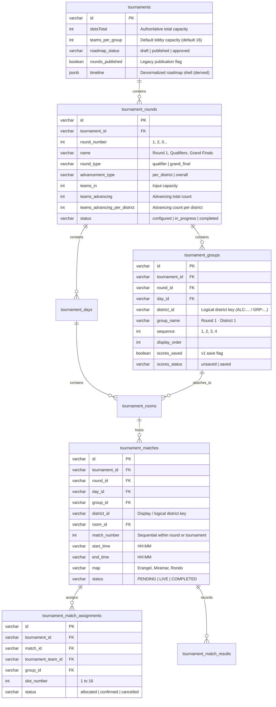
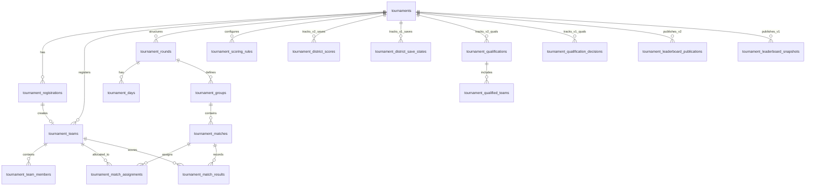

# MatchDistrict — Complete Read-Only Roadmap & Leaderboard Audit

> **Document Type:** Read-Only Codebase Audit & Architectural Discovery  
> **Target System:** Tournament Roadmap, Team Allocation, District Scoring, Leaderboard, Qualification & Publication  
> **Status:** Completed  
> **Date:** 2026-10-27  
> **Audit Environment:** Windows Local Workspace (`e:\Projects\MatchDistrict`), Node.js, PostgreSQL (Supabase pooler DDL / migrations), React 19 + Vite frontend.  
> **Rules Enforcement:** Non-negotiable read-only audit. No application code, configuration, schema, or database instances modified. No network or SQL queries executed against live instances.

---

## 1. Executive Summary

MatchDistrict's tournament lifecycle depends on a continuous pipeline: **Registration → Payment Approval → Roadmap Generation → Match Allocation → Match Scoring → Multi-Match Aggregation → Stage Qualification → Publication**.

The platform currently suffers from critical unreliability and workflow breakdown across the leaderboard and roadmap. This audit uncovered the root architectural and code causes:

1. **Dual Competing Architectures (Legacy v1 vs Leaderboard v2):**
   The repository contains two parallel, unintegrated implementations of scoring, qualification, district save states, and snapshots.
   - **Legacy v1 Architecture:** Operates across [server.js](file:///e:/Projects/MatchDistrict/server.js), [server/leaderboardService.js](file:///e:/Projects/MatchDistrict/server/leaderboardService.js), and [server/roundProgressionService.js](file:///e:/Projects/MatchDistrict/server/roundProgressionService.js). It reads/writes `tournament_district_save_states`, `tournament_qualification_decisions`, and `tournament_leaderboard_snapshots`.
   - **Leaderboard v2 Architecture:** Operates across [server/leaderboard/](file:///e:/Projects/MatchDistrict/server/leaderboard/) (`routes.js`, `standingsService.js`, `rosterService.js`, `districtSaveService.js`, `qualificationService.js`, `publicationService.js`). It reads/writes `tournament_district_scores`, `tournament_qualifications`, `tournament_qualified_teams`, `tournament_tie_resolutions`, and `tournament_leaderboard_publications`.
   - **Collision Point:** In [server.js#L13263-L13266](file:///e:/Projects/MatchDistrict/server.js#L13263-L13266), the v2 dispatcher intercepts `/leaderboard` requests and returns HTTP 410 Gone for root `/api/tournaments/:id/leaderboard` requests ([server/leaderboard/routes.js#L153-L157](file:///e:/Projects/MatchDistrict/server/leaderboard/routes.js#L153-L157)), rendering 180 lines of snapshot logic in `server.js` completely dead. Meanwhile, modal components in the frontend call different endpoints with divergent schemas and assumptions.

2. **The "Missing Allocated Teams" Editor Disconnect:**
   Normal standings in v1 queries all approved registrations from `tournament_registrations` ([server/leaderboardService.js#L574-L591](file:///e:/Projects/MatchDistrict/server/leaderboardService.js#L574-L591)), displaying teams even when match allocation has never occurred. However, the score editor ([TournamentLeaderboard.jsx#L246-L265](file:///e:/Projects/MatchDistrict/src/components/TournamentLeaderboard.jsx#L246-L265)) calls `/api/tournaments/:id/leaderboard/editor`, which delegates to [server/leaderboard/rosterService.js#L124-L132](file:///e:/Projects/MatchDistrict/server/leaderboard/rosterService.js#L124-L132), strictly querying `tournament_match_assignments WHERE status = 'allocated'`. Because approved registrations do not automatically generate match assignment records upon payment verification ([server/paymentReviewService.js#L789-L810](file:///e:/Projects/MatchDistrict/server/paymentReviewService.js#L789-L810)), the editor receives an empty roster (`roster: []`) and displays: *"This match has no allocated teams. Score entry is unavailable until the roadmap allocation is corrected."*

3. **Inconsistent District Catalogs & Identity Drifts:**
   Two distinct database tables represent groups/districts:
   - `tournament_registration_groups` (managed by [server/groupService.js](file:///e:/Projects/MatchDistrict/server/groupService.js) and [server/manualRoadmapService.js#L127-L187](file:///e:/Projects/MatchDistrict/server/manualRoadmapService.js#L127-L187)).
   - `tournament_groups` (managed by [server/manualRoadmapService.js#L1082-L1110](file:///e:/Projects/MatchDistrict/server/manualRoadmapService.js#L1082-L1110)).
   District IDs drift between formats such as `GRP-HGBC-01`, `ALC-1792928056901-1`, and random UUIDs. Pruning checks protect stale groups if any registration or assignment references them, causing tournaments reduced from 16 to 4 districts to permanently retain zombie districts.

4. **Multi-Match District Incompleteness Bug:**
   When a district contains multiple roadmap matches (e.g., Match 1 and Match 2), saving scores for Match 1 calculates completion across all district matches ([server/leaderboard/districtSaveService.js#L274-L292](file:///e:/Projects/MatchDistrict/server/leaderboard/districtSaveService.js#L274-L292)). Because Match 2 has no scores yet, `is_complete` is set to `false`. The frontend UI ([TournamentLeaderboard.jsx#L169](file:///e:/Projects/MatchDistrict/src/components/TournamentLeaderboard.jsx#L169)) sets `scores_saved = is_complete`, rendering the entire district as "Unsaved" despite the organizer just saving Match 1.

5. **Advancement Validation Error on Unplayed/Unassigned Teams:**
   The error *"Team 'TEAM-390555-171be7' did not play in source round 'Round 1' and cannot be advanced"* is triggered by [server/roundProgressionService.js#L921-L955](file:///e:/Projects/MatchDistrict/server/roundProgressionService.js#L921-L955). The participation check requires a team to appear in `tournament_match_assignments`, `tournament_match_results`, or have non-zero points in `tournament_leaderboard`. If a team was registered and approved but lacked match assignments or verified scores, advancement rejects it unless `allow_unverified: true` is passed. [server/leaderboard/qualificationService.js#L131](file:///e:/Projects/MatchDistrict/server/leaderboard/qualificationService.js#L131) calls `advanceTeamsManually` without passing this flag.

6. **Unapplied Table Schema Mismatch (`scoring_rules`):**
   The PostgreSQL error `column "scoring_rules" does not exist` ([server.js#L7175](file:///e:/Projects/MatchDistrict/server.js#L7175)) occurred because code in `server/roundProgressionService.js#L1472` and `server.js#L13614` queried `SELECT scoring_rules FROM tournaments WHERE id = $1`. Scoring configuration actually lives in the dedicated relational table `tournament_scoring_rules`.

---

## 2. Audit Scope and Limitations

### In-Scope Systems
- **Roadmap Data Model & Lifecycle:** Pre-tournament capacity derivation, round/day/district/room/match hierarchy, manual editor, generation algorithm, saving drafts, and publishing.
- **Team Allocation & Roster Contracts:** Registration approval, team identity creation, group stamping, match assignment insertion, slot numbering, and snake seeding.
- **Leaderboard Views & State Flow:** Standings computation, district selectors, team count calculations, slot-ordered score editing, optimistic concurrency, and tie-breaking.
- **Scoring & Aggregation Model:** Placement scoring table, kill multiplier, WWCD counting, multi-match aggregation, and save transactions.
- **Qualification & Advancement:** Scope-aware qualification, Method A (per district), Method B (overall), cutoff tie detection/resolution, preview vs confirm, and target-round seating.
- **Publication & Participant Views:** Snapshot creation, hashing, versioning, publication state tracking, and participant read isolation.
- **Test Injection & Data Isolation:** Mock team creation, batch markers, provenance tracking, and foreign-key scoped cleanup.

### Explicit Limitations
- **Read-Only Inspection:** No database migrations or DDL statements were executed against live databases. Live database state, historical schema drifts, and production connection parameters were not inspected.
- **Static Code Tracing:** Dynamic runtime values (such as live pool connections or production Redis/memory state) are inferred strictly from repository code and error logs.
- **No Implementation Fixes:** This document documents defects, gaps, and contracts for a subsequent design phase; no application code has been edited.

---

## 3. Verified Architecture

### 3.1 Technology Stack & Runtime Topology
- **Backend Runtime:** Node.js (ESM modules), custom HTTP server dispatch in [server.js](file:///e:/Projects/MatchDistrict/server.js).
- **Database Layer:** PostgreSQL accessed via `pg` pool in [server/db.js](file:///e:/Projects/MatchDistrict/server/db.js) connecting to Supabase Session pooler over TLS (`rejectUnauthorized: false`).
- **Frontend Framework:** React 19, Vite, React Router, Tailwind CSS, Lucide icons.
- **Authentication:** Custom HMAC-SHA256 JWTs stored in HttpOnly cookies (`token`, `admin_token`) and mirrored in auth response bodies, verified via [server/tournamentAuth.js](file:///e:/Projects/MatchDistrict/server/tournamentAuth.js).

### 3.2 High-Level Architecture Diagram

```mermaid
flowchart TD
    subgraph UI ["Frontend UI (React 19)"]
        TD["TournamentDetail.jsx"]
        TL["TournamentLeaderboard.jsx"]
        TRB["TournamentRoadmapBuilder.jsx"]
        RQM["RoadmapQualifyModal.jsx"]
        QTM["QualifyTeamsModal.jsx"]
        RQP["RoundQualifyPanel.jsx (Legacy)"]
    end

    subgraph Dispatcher ["HTTP Route Dispatch (server.js)"]
        RD_ROADS["/api/tournaments/:id/roadmap/*"]
        RD_V2["/api/tournaments/:id/leaderboard/* (handleLeaderboardRoutes)"]
        RD_LEGACY_QUAL["/api/tournaments/:id/rounds/preview-qualify & confirm-qualify"]
        RD_LEGACY_ADV["/api/tournaments/:id/rounds/:roundId/advance"]
        RD_INJECT["/api/admin/tournaments/:id/*test-injection*"]
    end

    subgraph ServicesV2 ["Leaderboard v2 Domain Layer"]
        RosterSvc["rosterService.js (Match Assignments)"]
        StandingsSvc["standingsService.js (Read-only Aggregation)"]
        DistrictSaveSvc["districtSaveService.js (Optimistic Concurrency)"]
        QualSvc["qualificationService.js (Preview/Confirm)"]
        PubSvc["publicationService.js (Snapshots)"]
        RankSvc["rankingService.js (5-tier tie break)"]
        ScoreCfg["scoringConfig.js (Authoritative Rules)"]
    end

    subgraph ServicesLegacy ["Legacy Domain Layer"]
        LeaderboardSvc["leaderboardService.js"]
        ProgressionSvc["roundProgressionService.js"]
        ManualRoadmapSvc["manualRoadmapService.js"]
        GroupSvc["groupService.js"]
        AllocSvc["allocationService.js"]
    end

    subgraph Database ["PostgreSQL Schema"]
        T_ROUNDS["tournament_rounds"]
        T_GROUPS["tournament_groups"]
        T_REG_GROUPS["tournament_registration_groups"]
        T_MATCHES["tournament_matches"]
        T_ASSIGN["tournament_match_assignments"]
        T_RESULTS["tournament_match_results"]
        T_SCORING["tournament_scoring_rules"]
        T_DIST_SCORES["tournament_district_scores (v2)"]
        T_DIST_SAVES["tournament_district_save_states (v1)"]
        T_QUAL_DEC["tournament_qualification_decisions (v1)"]
        T_QUAL["tournament_qualifications & tournament_qualified_teams (v2)"]
        T_PUBS["tournament_leaderboard_publications (v2)"]
        T_SNAPS["tournament_leaderboard_snapshots (v1)"]
    end

    TL --> RD_V2
    RQM --> RD_V2
    QTM --> RD_V2
    RQP --> RD_LEGACY_QUAL
    RQP --> RD_LEGACY_ADV
    TRB --> RD_ROADS

    RD_V2 --> RosterSvc
    RD_V2 --> StandingsSvc
    RD_V2 --> DistrictSaveSvc
    RD_V2 --> QualSvc
    RD_V2 --> PubSvc

    RD_LEGACY_QUAL --> ProgressionSvc
    RD_LEGACY_ADV --> ProgressionSvc
    RD_ROADS --> ManualRoadmapSvc

    RosterSvc --> T_ASSIGN
    StandingsSvc --> T_RESULTS
    DistrictSaveSvc --> T_DIST_SCORES
    DistrictSaveSvc --> T_DIST_SAVES
    DistrictSaveSvc --> T_RESULTS
    QualSvc --> T_QUAL
    QualSvc --> ProgressionSvc
    PubSvc --> T_PUBS
    ProgressionSvc --> T_QUAL_DEC
    ProgressionSvc --> T_SNAPS
```



---

## 4. Component and Service Inventory

| Area | File or Symbol | Responsibility | Calls or Dependencies | Current Concerns |
| :--- | :--- | :--- | :--- | :--- |
| **Leaderboard UI** | [src/components/TournamentLeaderboard.jsx](file:///e:/Projects/MatchDistrict/src/components/TournamentLeaderboard.jsx) | Renders standings, match score editing, district selector, publication badges, and qualification triggers. | Calls `/leaderboard/structure`, `/leaderboard/standings`, `/leaderboard/editor`, `/leaderboard/districts/:id/scores`, `/leaderboard/publication/*`. | Mounts three separate qualification modals; district save state sets `scores_saved` strictly from `is_complete`; hides qualification trigger in terminal rounds. |
| **Score Editor** | [TournamentLeaderboard.jsx#L1235-L1362](file:///e:/Projects/MatchDistrict/src/components/TournamentLeaderboard.jsx#L1235-L1362) | District-level score entry table in slot order with per-match selector tabs. | Depends on `activeMatchScoreEntry`, calls `saveDistrictScores`. | Reports false empty state if no match assignments exist; saving one match causes entire district to show incomplete. |
| **Qualification Modal (Roadmap)** | [src/components/leaderboard/RoadmapQualifyModal.jsx](file:///e:/Projects/MatchDistrict/src/components/leaderboard/RoadmapQualifyModal.jsx) | Two-step preview and confirmation modal for Method A and Method B qualification. | Calls `/leaderboard/qualification/preview` and `/confirm`. | Relies on `targetRound` passed from parent, which is null on terminal rounds; provisional checkbox blocks confirm if unsaved districts exist. |
| **Qualification Modal (Manual)** | [src/components/leaderboard/QualifyTeamsModal.jsx](file:///e:/Projects/MatchDistrict/src/components/leaderboard/QualifyTeamsModal.jsx) | Allows organizers to select specific checked teams and advance them. | Calls `/leaderboard/qualification/manual`. | Fails if selected teams lack match participation records in `roundProgressionService.js`. |
| **Qualification Panel (Legacy)** | [src/components/qualification/RoundQualifyPanel.jsx](file:///e:/Projects/MatchDistrict/src/components/qualification/RoundQualifyPanel.jsx) | Legacy advancement summary and advancement panel mounted in Leaderboard tab. | Calls `/rounds/:id/advancement-summary` and `/rounds/:id/advance`. | Competing duplicate UI; uses outdated payload schema and separate progression error formatters. |
| **Roadmap Builder** | [src/components/TournamentRoadmapBuilder.jsx](file:///e:/Projects/MatchDistrict/src/components/TournamentRoadmapBuilder.jsx) | Hierarchical roadmap configuration editor (rounds, days, districts, rooms, matches). | Calls `/roadmap/districts`, `/roadmap/draft`, `/roadmap/save`, `/roadmap/publish`. | Derives `effectiveDistricts` by mixing database districts and round allocations; retains zombie districts if registrations reference them. |
| **Leaderboard Dispatcher** | [server/leaderboard/routes.js](file:///e:/Projects/MatchDistrict/server/leaderboard/routes.js) | Dispatches Leaderboard v2 endpoints under `/api/tournaments/:id/leaderboard/*`. | `standingsService.js`, `rosterService.js`, `districtSaveService.js`, `qualificationService.js`, `publicationService.js`. | Explicitly returns HTTP 410 Gone for `/leaderboard` root and `/publish`, deadlocking legacy routes in `server.js`. |
| **Roster Service** | [server/leaderboard/rosterService.js](file:///e:/Projects/MatchDistrict/server/leaderboard/rosterService.js) | Authoritative team directory and match/district rosters in slot order. | Queries `tournament_teams`, `tournament_registrations`, and `tournament_match_assignments`. | Relies exclusively on `tournament_match_assignments`; cannot fall back to approved registrations. |
| **District Save Service** | [server/leaderboard/districtSaveService.js](file:///e:/Projects/MatchDistrict/server/leaderboard/districtSaveService.js) | Atomic transactional saving of district match scores with optimistic locking. | Queries/updates `tournament_district_scores`, `tournament_district_save_states`, `tournament_match_results`. | Evaluates `is_complete` as all matches scored; saving one match leaves status as `incomplete`. |
| **Standings Service** | [server/leaderboard/standingsService.js](file:///e:/Projects/MatchDistrict/server/leaderboard/standingsService.js) | Computes read-only district and round standings from match results. | Calls `getDistrictRoster`, `getResultsForMatches`, `rankTeams`. | Aggregates only teams returned by `rosterService`; teams without match assignments do not appear. |
| **Legacy Progression Service** | [server/roundProgressionService.js](file:///e:/Projects/MatchDistrict/server/roundProgressionService.js) | Handles round advancement, snake seeding, qualification preview, and detailed standings. | Queries `tournament_rounds`, `tournament_groups`, `tournament_match_assignments`, `tournament_match_results`. | Contains strict `TEAM_DID_NOT_PLAY_SOURCE_ROUND` check; previously contained invalid `scoring_rules` SQL query. |
| **Legacy Leaderboard Service** | [server/leaderboardService.js](file:///e:/Projects/MatchDistrict/server/leaderboardService.js) | Computes standings and saves district scores under v1 contracts. | Queries `tournament_leaderboard`, `tournament_scoring_rules`, `tournament_match_results`. | Duplicates ranking rules, score calculations, and contains a competing `saveDistrictScores` function. |
| **Manual Roadmap Service** | [server/manualRoadmapService.js](file:///e:/Projects/MatchDistrict/server/manualRoadmapService.js) | Persists hierarchical roadmap entities, retrieves district layouts, manages credentials. | Queries/updates `tournament_rounds`, `tournament_days`, `tournament_groups`, `tournament_rooms`, `tournament_matches`. | Prunes obsolete registration groups only if completely unassigned; preserves group rows if `group_id` is set on registrations. |
| **Allocation Service** | [server/allocationService.js](file:///e:/Projects/MatchDistrict/server/allocationService.js) | Allocates teams to rooms and matches automatically or manually. | Updates `tournament_match_assignments`, locks `tournaments` and `tournament_teams`. | Not invoked during payment approval; requires explicit manual trigger or team verification flow. |
| **Test Data Cleanup Service** | [server/testDataCleanupService.js](file:///e:/Projects/MatchDistrict/server/testDataCleanupService.js) | Inspects and safely purges test-injected dummy registrations and dependencies. | Deletes from 10 dependent tables in reverse-FK order inside a transaction. | Blocks deletion if any payment submission or prize payout is linked to test records. |

---

## 5. Roadmap System Audit

### 5.1 Roadmap Data Model
The tournament roadmap is stored in a relational hierarchy across 5 primary database tables, supplemented by configuration fields in `tournaments`:



#### Authoritative Columns vs Derived / Competing Representations
- **Tournament Capacity:** Authoritative: `tournaments."slotsTotal"` ([server/schemaMigrations.js#L358](file:///e:/Projects/MatchDistrict/server/schemaMigrations.js#L358)). Competing/Derived: `round.teams_in` in `tournament_rounds` and `meta.total_slots` in frontend state.
- **District Identity:** Authoritative: `tournament_groups.id` ([server/schemaMigrations.js#L425](file:///e:/Projects/MatchDistrict/server/schemaMigrations.js#L425)). Competing: `tournament_groups.district_id`, `tournament_registration_groups.id`, and `tournament_matches.district_id`.
- **Match Identity:** Authoritative: `tournament_matches.id` ([server/schemaMigrations.js#L450](file:///e:/Projects/MatchDistrict/server/schemaMigrations.js#L450)).
- **Match Capacity:** Computed from attached room: `tournament_rooms.capacity` (default 16) or `tournament_registration_groups.capacity`.
- **Roadmap Status:** Authoritative: `tournaments.roadmap_status` (`draft`, `published`, `approved`). Competing: `tournaments.rounds_published` (boolean) and `tournaments."isDraft"`.

### 5.2 Roadmap Lifecycle

1. **Generation:** Organizer initiates wizard or calls `POST /api/tournaments/:id/roadmap/generate` ([server.js#L9198](file:///e:/Projects/MatchDistrict/server.js#L9198)). `server/roadmapGenerator.js` calculates stages and progression plan funneled into a 1-lobby Grand Final.
2. **Draft Saving:** Frontend posts hierarchical tree to `POST /api/tournaments/:id/roadmap/save` ([server.js#L9069](file:///e:/Projects/MatchDistrict/server.js#L9069)). Handled by `server/manualRoadmapService.js:saveManualRoadmapDraft` ([server/manualRoadmapService.js#L757](file:///e:/Projects/MatchDistrict/server/manualRoadmapService.js#L757)).
   - Updates `tournament_rounds`, `tournament_days`, `tournament_groups`, `tournament_rooms`, `tournament_matches` in place.
   - Deletes removed matches only if they have no records in `tournament_match_results` ([server/manualRoadmapService.js#L1235-L1251](file:///e:/Projects/MatchDistrict/server/manualRoadmapService.js#L1235-L1251)).
   - Deletes removed groups only if `protectedGroupIds` does NOT contain them ([server/manualRoadmapService.js#L1265-L1271](file:///e:/Projects/MatchDistrict/server/manualRoadmapService.js#L1265-L1271)). If teams are allocated to a group, the save transaction **aborts with an error**, preventing the organizer from removing the district without manual reallocation.
3. **Publication:** `POST /api/tournaments/:id/roadmap/publish` ([server.js#L9118](file:///e:/Projects/MatchDistrict/server.js#L9118)) sets `tournaments.roadmap_status = 'published'` and `rounds_published = true`. Public endpoints strip room credentials (`roomID`, `roomPassword`).
4. **Post-Allocation Edits:** Modifying dates, times, maps, and notes is allowed. Modifying stage advancement rules or deleting rounds with verified results is blocked with `ROUND_STRUCTURALLY_LOCKED` ([server/manualRoadmapService.js#L805-L839](file:///e:/Projects/MatchDistrict/server/manualRoadmapService.js#L805-L839)).

### 5.3 Capacity and District Calculations
- **Calculation Rule:** `requiredDistricts = Math.ceil(slotsTotal / teamsPerGroup)` ([server/roadmapConfig.js#L91-L97](file:///e:/Projects/MatchDistrict/server/roadmapConfig.js#L91-L97)).
- **Concrete Example (64 Teams, 16 Lobby Capacity):**
  - Expected: `ceil(64 / 16) = 4` districts (District 1 to District 4), each with 16 teams.
  - Distribute Sizes: `distributeDistrictSizes(64, 16)` returns `[16, 16, 16, 16]`.
  - Concrete Example with Remainder (65 Teams, 16 Capacity): `ceil(65 / 16) = 5` districts. `distributeDistrictSizes(65, 16)` returns `[13, 13, 13, 13, 13]` (balanced) or `[17, 16, 16, 16]` depending on planner configuration.
- **Why Tournaments Show Too Many Districts:**
  If a tournament was originally created with 100 slots (`ceil(100/16) = 7` districts) or 256 slots (16 districts) and later edited down to 64 slots:
  - In [server/manualRoadmapService.js#L140-L165](file:///e:/Projects/MatchDistrict/server/manualRoadmapService.js#L140-L165), obsolete groups (`group_index > 4`) are checked against `tournament_registrations` and `tournament_match_assignments`.
  - If any dummy or real registration remains stamped with `group_id` for District 5 or District 6, the cleanup is bypassed:
    `if (assignedCheck.rows.length === 0 && matchAllocCheck.rows.length === 0) { DELETE ... }`.
  - As a result, District 5, 6, and 7 remain in the database.
  - In [TournamentRoadmapBuilder.jsx#L170-L188](file:///e:/Projects/MatchDistrict/src/components/TournamentRoadmapBuilder.jsx#L170-L188), `effectiveDistricts` includes these districts if `d.registered_teams_count > 0` or `d.has_conflict`, polluting the active district list.

### 5.4 Roadmap-to-Allocation Contract
A team assignment is canonically keyed by:
`tournament_match_assignments (match_id, tournament_team_id)` with columns:
- `tournament_id`: Scope constraint.
- `match_id`: Authoritative match foreign key.
- `tournament_team_id`: Canonical team ID (`TEAM-...` in `tournament_teams.id`).
- `group_id`: District/group identifier.
- `slot_number`: Assigned slot (1 to 16).
- `status`: `'allocated'`.

#### Display Labels vs Canonical Keys
- Canonical Key: `tournament_groups.id` or `tournament_groups.district_id`.
- Display Label: `tournament_groups.group_name` (e.g., `"Round 1 · District 1"`).
- Fallback Mapping: In `src/components/roadmap/RoadmapDaysDistricts.jsx` and `TournamentLeaderboard.jsx`, when `district_name` is missing, the frontend derives labels via `District ${group_index || sequence || 1}`.
- Mismatch Danger: In `manualRoadmapService.js#L1187-L1226`, `tournament_matches.group_name` is stored as `distName` (e.g. `"District 1"`), while `tournament_matches.district_id` is stored as `distId` (e.g. `"ALC-1792928056901-1"`), creating naming drift across queries.

### 5.5 Roadmap Invariants Matrix

| Invariant | Status | Code Evidence | Notes |
| :--- | :--- | :--- | :--- |
| Every match belongs to a valid round | **Verified** | [server/manualRoadmapService.js#L1187-L1200](file:///e:/Projects/MatchDistrict/server/manualRoadmapService.js#L1187-L1200) | `tournament_matches.round_id` enforced in SQL. |
| Every district belongs to a valid round | **Verified** | [server/manualRoadmapService.js#L1099-L1108](file:///e:/Projects/MatchDistrict/server/manualRoadmapService.js#L1099-L1108) | `tournament_groups.round_id` enforced in SQL. |
| Match cannot exceed configured capacity | **Partial** | [server/leaderboard/scoringConfig.js#L231-L235](file:///e:/Projects/MatchDistrict/server/leaderboard/scoringConfig.js#L231-L235) | Enforced during score entry validation; not strictly constrained at DB foreign-key level. |
| Team cannot be in conflicting matches in same round | **Partial** | [server/allocationService.js#L157-L175](file:///e:/Projects/MatchDistrict/server/allocationService.js#L157-L175) | Enforced in allocation service transactions; no database uniqueness constraint on `(round_id, tournament_team_id)`. |
| Slot numbers unique within match | **Verified** | [server/allocationService.js#L163-L166](file:///e:/Projects/MatchDistrict/server/allocationService.js#L163-L166) | Queries `SELECT slot_number FROM tournament_match_assignments WHERE match_id = $1` to find next free slot. |
| District counts match capacity plan | **Partial** | [server/leaderboard/routes.js#L266-L274](file:///e:/Projects/MatchDistrict/server/leaderboard/routes.js#L266-L274) | Warning emitted (`district_capacity_mismatch`) when `districts.length !== expectedR1Districts`, but execution continues. |
| Qualified teams use target round structure | **Verified** | [server/roundProgressionService.js#L1720-L1739](file:///e:/Projects/MatchDistrict/server/roundProgressionService.js#L1720-L1739) | Target groups are freshly queried; snake seeding allocates into target round groups. |
| Editing roadmap preserves saved scores | **Verified** | [server/manualRoadmapService.js#L759-L764](file:///e:/Projects/MatchDistrict/server/manualRoadmapService.js#L759-L764) | Matches with rows in `tournament_match_results` are locked from deletion. |

---

## 6. Team Registration and Allocation Audit

### 6.1 Complete Team Data Path

```mermaid
sequenceDiagram
    autonumber
    actor Participant
    actor Organizer
    participant Reg as tournament_registrations
    participant Teams as tournament_teams
    participant Alloc as allocationService.js
    participant Assign as tournament_match_assignments
    participant Scores as tournament_match_results
    participant Standings as Leaderboard Standings

    Participant->>Reg: Register squad (POST /api/tournaments/:id/register)
    Note over Reg: Status = 'pending_payment'
    Participant->>Reg: Upload UTR & Proof (POST /api/tournaments/:id/payments)
    Note over Reg: Status = 'pending' (pending_review)

    Organizer->>Reg: Approve Payment (POST /api/admin/payment-reviews/:id/approve)
    Note over Reg: Status = 'approved'
    Reg->>Teams: ensureTeamForRegistrationSafe() creates tournament_teams row
    Note over Teams: Status = 'awaiting_members', linked by registration_id

    alt Verification / Manual Allocation
        Organizer->>Alloc: allocateTeam(teamId, matchId)
        Alloc->>Assign: INSERT INTO tournament_match_assignments (status='allocated')
    else Automatic Match Allocation (Omitted on payment approval)
        Note over Assign: NO ASSIGNMENTS CREATED AUTOMATICALLY
    end

    Organizer->>Scores: Enter & Save Scores (PUT /leaderboard/districts/:id/scores)
    Note over Scores: Validates against match roster; saves results

    Standings->>Standings: computeDistrictStandings() reads tournament_match_assignments
```

#### Key Relationships and Primary Keys
1. **Registration:** Table `tournament_registrations`, Primary Key `id` (`REG-...`). Foreign Key `tournament_id`.
2. **Team:** Table `tournament_teams`, Primary Key `id` (`TEAM-...`). Foreign Key `registration_id` references `tournament_registrations.id`, `leader_user_id` references `users.id`.
3. **Members:** Table `tournament_team_members`, Primary Key `id` (`MEM-...`). Foreign Key `tournament_team_id` references `tournament_teams.id`, `user_id` references `users.id`.
4. **Match Assignment:** Table `tournament_match_assignments`, Primary Key `id` (`ASN-...`). Foreign Keys: `match_id` references `tournament_matches.id`, `tournament_team_id` references `tournament_teams.id`, `group_id` references `tournament_groups.id`.

### 6.2 Eligibility Rules Matrix

| Consumer / Query | File & Line Range | Eligibility Criteria | Status Filters | Disqualification Handling |
| :--- | :--- | :--- | :--- | :--- |
| **Normal Standings (v2)** | [server/leaderboard/standingsService.js#L56-L102](file:///e:/Projects/MatchDistrict/server/leaderboard/standingsService.js#L56-L102) | Teams returned by `getDistrictRoster` (must have assigned row in `tournament_match_assignments`). | `tournament_match_assignments.status = 'allocated'`. | Visible; `is_disqualified` flagged boolean; ranks below active teams. |
| **Normal Standings (v1)** | [server/leaderboardService.js#L573-L625](file:///e:/Projects/MatchDistrict/server/leaderboardService.js#L573-L625) | Round 1: All approved registrations in `tournament_registrations`. Round 2+: Must be in `tournament_match_assignments`. | `status IN ('approved', 'confirmed', 'verified_by_host')`. | Flagged `DQ`; visible in table. |
| **District Selector Count** | [server/leaderboard/routes.js#L228-L244](file:///e:/Projects/MatchDistrict/server/leaderboard/routes.js#L228-L244) | Count of assigned teams in `tournament_match_assignments` for matches in that district. | `a.status = 'allocated'`. | Included in count if assigned. |
| **Score Editor** | [server/leaderboard/rosterService.js#L124-L132](file:///e:/Projects/MatchDistrict/server/leaderboard/rosterService.js#L124-L132) | Strictly assigned teams in `tournament_match_assignments` for the selected match. | `a.status = 'allocated'`. | Visible in editor; organizer can still input finish position/kills unless disqualified. |
| **Qualification Preview (v2)** | [server/leaderboard/qualificationService.js#L38-L42](file:///e:/Projects/MatchDistrict/server/leaderboard/qualificationService.js#L38-L42) | Teams in `standingsData.districts` or `overallStandings` from `getDetailedRoundStandings`. | Registered approved + allocated. | Filtered out: `!t.is_disqualified`. |
| **Manual Qualification** | [server/leaderboard/qualificationService.js#L126-L130](file:///e:/Projects/MatchDistrict/server/leaderboard/qualificationService.js#L126-L130) | Teams in `overallStandings` where `is_assigned && !is_disqualified`. | Allocated and non-disqualified. | Excluded from eligible map. |
| **Round Advancement Execution** | [server/roundProgressionService.js#L921-L955](file:///e:/Projects/MatchDistrict/server/roundProgressionService.js#L921-L955) | Must appear in `tournament_match_assignments`, `tournament_match_results`, or non-zero in `tournament_leaderboard`. | Assigned or recorded score. | Excluded if disqualified. |

### 6.3 Root Cause of Allocation Discrepancies
The discrepancy where standings display teams but score editing reports no allocated teams occurs because:
1. `TournamentLeaderboard.jsx` loads standings via `/leaderboard/standings`. In legacy or snapshot data, teams appear because they are approved registrations.
2. When the user clicks "Edit Scores", the client calls `/leaderboard/editor?roundId=...&districtId=...`.
3. In [server/leaderboard/routes.js#L510-L538](file:///e:/Projects/MatchDistrict/server/leaderboard/routes.js#L510-L538), the editor endpoint queries `getMatchRoster(pool, m.id)`.
4. `getMatchRoster` executes:
   ```sql
   SELECT a.id, a.tournament_team_id, a.slot_number
   FROM tournament_match_assignments a
   WHERE a.match_id = $1::varchar AND a.status = 'allocated'
   ```
5. If the tournament was created and approved, but the organizer did not run the team allocation step (or automatic allocation was not hooked into payment approval), `tournament_match_assignments` contains 0 rows for that match.
6. The editor receives `roster: []`. In [TournamentLeaderboard.jsx#L321](file:///e:/Projects/MatchDistrict/src/components/TournamentLeaderboard.jsx#L321), `activeMatchAllocationState` evaluates to `'empty'`, rendering:
   ```jsx
   <td colSpan={4} className="px-5 py-8 text-center text-sm text-amber-700 dark:text-amber-300">
     This match has no allocated teams. Score entry is unavailable until the roadmap allocation is corrected.
   </td>
   ```

---

## 7. Leaderboard UI and State Audit

### 7.1 View Matrix

| View | Data Source & Endpoint | Loading & Empty State | Selection & Sorting | Current Implementation Concerns |
| :--- | :--- | :--- | :--- | :--- |
| **Overall Standings** | `GET /leaderboard/standings?roundId=...` | Loading skeleton; empty banner "No Standings Available". | Sorted by `rankTeams` (Total Points DESC). | Must never display a "District" column; displays teams combined across all districts. |
| **Round Standings** | `GET /leaderboard/standings?roundId=...` | Same as overall. | Sorted by `rankTeams`. | Scope indicator displays Round name. |
| **District Standings** | `GET /leaderboard/standings?roundId=...&districtId=...` | Empty banner "No Teams Assigned to [District Name]". | Sorted by `rankTeams`. | If `districtId` query param does not match DB ID, returns HTTP 400 `INVALID_DISTRICT`. |
| **Match Score Editor** | `GET /leaderboard/editor?roundId=...&districtId=...` | Inline spinner; displays empty message if `roster.length === 0`. | Sorted strictly by `slot_number ASC` ([TournamentLeaderboard.jsx#L325-L336](file:///e:/Projects/MatchDistrict/src/components/TournamentLeaderboard.jsx#L325-L336)). | Editor organize around active match; switching matches loses unsaved drafts if not buffered in component state. |
| **Roadmap Qualify Modal** | `POST /leaderboard/qualification/preview` | Modal spinner; displays `zero_qualifiers_reason` on 0 teams. | Checkbox list of tied teams; preview list of qualifiers. | Relies on `targetRound`; modal fails to open if target round is null (Grand Finals). |
| **Manual Qualify Modal** | `POST /leaderboard/qualification/manual` | Spinner during submit. | Checkbox list of eligible teams. | Does not pass `allow_unverified: true`, failing advancement if scores are unrecorded. |
| **Published Participant View** | `GET /leaderboard/published?roundId=...` or `/standings` (when non-organizer) | Banner: "Results not published yet". | Read-only table of active snapshot. | Does not display qualification status checkmarks because snapshots omit qualification table rows. |

### 7.2 District Selector and Team Counts
- **Label Format:** `"Round 1 · District 1 (16/16)"` or `(0/16)`.
- **Numerator:** Count of teams in `tournament_match_assignments` for that district's matches (`dist.team_count` from [server/leaderboard/routes.js#L242](file:///e:/Projects/MatchDistrict/server/leaderboard/routes.js#L242)).
- **Denominator:** Lobby capacity from roadmap (`dist.capacity` = 16).
- **Discrepancy Trigger:** If table rows are loaded from a published snapshot (e.g. 16 teams), but `structure` reports 0 allocated match assignments in live DB, the button displays `(0/16)` while the table displays 16 rows.

### 7.3 Sorting, Ranking, and Tie-Break Hierarchy
Ranking is computed authoritatively on the server in [server/leaderboard/rankingService.js:compareTeams](file:///e:/Projects/MatchDistrict/server/leaderboard/rankingService.js#L24-L80):
1. **Disqualified Teams:** Always sort to the bottom.
2. **Played vs Unplayed:** Teams with `matches_played > 0` rank above teams with no played matches.
3. **Total Points:** Descending (`total_points = total_kill_points + total_placement_points`).
4. **Total WWCDs:** Descending (numeric count of 1st-place finishes).
5. **Total Placement Points:** Descending.
6. **Total Elimination Points:** Descending (`kills × multiplier`, counted once).
7. **Recent Match Placement:** Lower finish position in most recent match ranks higher.
8. **True Tie:** If all criteria are equal, returns `0`. [server/leaderboard/rankingService.js#L113-L129](file:///e:/Projects/MatchDistrict/server/leaderboard/rankingService.js#L113-L129) assigns dense tied ranks (e.g., `T-2`, `T-2`, `4`).

---

## 8. Scoring Model Audit

### 8.1 Scoring Schema and Rules
- **Rule Contract:**
  $$\text{Total Points} = \text{Kill Points} + \text{Placement Points}$$
- **Kill Points:** $\text{Total Kills} \times \text{Kill Multiplier}$ (default 1.0).
- **Placement Points Table:**
  - 1st Place: 10 pts
  - 2nd Place: 6 pts
  - 3rd Place: 5 pts
  - 4th Place: 4 pts
  - 5th Place: 3 pts
  - 6th Place: 2 pts
  - 7th–8th Place: 1 pt
  - 9th–16th+ Place: 0 pts
- **Organizer Input:** Organizer enters only **Finish Position** (1–16) and **Kills** (0–99).
- **Database Storage:**
  - Per-match results stored in `tournament_match_results` ([server/schemaMigrations.js#L476-L498](file:///e:/Projects/MatchDistrict/server/schemaMigrations.js#L476-L498)).
  - `placement`: INTEGER (1 to match capacity).
  - `kills`: INTEGER (0 to 99).
  - `kill_points`: INTEGER (derived on server).
  - `placement_points`: INTEGER (derived on server).
  - `wwcd`: BOOLEAN (`true` if `placement === 1`, else `false`).
  - `total_points`: INTEGER (`kill_points + placement_points`).

### 8.2 WWCD Semantics
- In `tournament_match_results`, WWCD is stored as a **boolean** (`wwcd = true` when `placement = 1`).
- In `tournament_leaderboard` and standings aggregates, WWCD is stored and rendered as an **integer count** ($\ge 0$, e.g., `0`, `1`, `2`).
- Aggregation query in [server/leaderboardService.js#L464](file:///e:/Projects/MatchDistrict/server/leaderboardService.js#L464):
  `SUM(CASE WHEN tm.wwcd THEN 1 ELSE 0 END)::int as wwcd_count`.
- In [server/leaderboard/resultsService.js#L80](file:///e:/Projects/MatchDistrict/server/leaderboard/resultsService.js#L80), WWCD is derived as:
  `wwcd: row.wwcd === true || Number(row.wwcd) === 1 || Number(row.placement) === 1 ? 1 : 0`.

### 8.3 Multi-Match Aggregation
Example: Round 1, District 1 containing Match 1 and Match 2.
1. Match 1 results and Match 2 results are stored as separate rows in `tournament_match_results` with distinct `match_id` values.
2. Standings calculation in [server/leaderboard/standingsService.js#L56-L102](file:///e:/Projects/MatchDistrict/server/leaderboard/standingsService.js#L56-L102) loops over all district matches:
   - `matchesPlayed += 1`
   - `totalKills += res.kills`
   - `totalKillPoints += res.kill_points`
   - `totalPlacementPoints += res.placement_points`
   - `totalPoints += res.total_points`
   - `wwcdCount += (res.wwcd === 1 ? 1 : 0)`
3. Missing scores remain `null`, rendering `"No scores yet"` with rank `"-"` in normal standings.
4. **The Flaw:** When saving Match 1, the completion check in [server/leaderboard/districtSaveService.js#L274-L292](file:///e:/Projects/MatchDistrict/server/leaderboard/districtSaveService.js#L274-L292) verifies whether *all* matches in the district are complete. Because Match 2 has no scores yet, `is_complete` is saved as `false`, causing the UI to show the entire district as "Unsaved".

---

## 9. District-Level Save and Persistence Audit

### 9.1 Save Mechanism & Transaction Boundary
- **Endpoint:** `PUT /api/tournaments/:id/leaderboard/districts/:districtId/scores` ([server/leaderboard/routes.js#L559](file:///e:/Projects/MatchDistrict/server/leaderboard/routes.js#L559)).
- **Transaction Scope:** Handled in [server/leaderboard/districtSaveService.js:saveDistrictScores](file:///e:/Projects/MatchDistrict/server/leaderboard/districtSaveService.js#L131-L370).
- **Execution Steps:**
  1. Validates input scores against match rosters outside the transaction.
  2. Acquires row lock on tournament: `SELECT id FROM tournaments WHERE id = $1 FOR UPDATE`.
  3. Checks optimistic lock version in `tournament_district_scores` (or `tournament_district_save_states`).
  4. If `expectedVersion !== currentVersion`, rolls back and throws HTTP 409 `VERSION_CONFLICT`.
  5. Inserts/updates `tournament_match_results` rows for each team.
  6. Writes audit record into `tournament_match_results_audit`.
  7. Calculates `matchesWithFullScores` and updates `tournament_district_scores` and `tournament_district_save_states` with incremented version (`version + 1`).
  8. Commits transaction.

---

## 10. Qualification and Advancement Audit

### 10.1 Qualification Workflows
1. **Roadmap Method A (Top N per District):**
   Ranks teams independently within each district. Top $N$ advance from each district.
2. **Roadmap Method B (Top N Overall):**
   Combines standings across the entire round. Top $N$ teams overall advance regardless of district.
3. **Manual Qualification:**
   Organizer selects specific teams in the leaderboard table and advances them directly.

### 10.2 Preview and Confirmation
- **Preview (`POST /leaderboard/qualification/preview`):**
  Performs **zero database writes**. Validates configuration, ranks eligible teams, detects true ties at cutoff, computes snake seeding preview into target groups, and returns a SHA-256 `preview_hash` ([server/leaderboard/qualificationService.js#L38-L42](file:///e:/Projects/MatchDistrict/server/leaderboard/qualificationService.js#L38-L42)).
- **Confirm (`POST /leaderboard/qualification/confirm`):**
  Requires matching `preview_hash`. If data changed between preview and confirmation, rejects with HTTP 409 `STALE_PREVIEW` ([server/leaderboard/qualificationService.js#L48-L53](file:///e:/Projects/MatchDistrict/server/leaderboard/qualificationService.js#L48-L53)). Idempotently writes to `tournament_qualifications`, `tournament_qualified_teams`, and seeds teams into target round match assignments.

### 10.3 Analysis of Reported Qualification Errors

#### Error 1: Missing column "scoring_rules"
- **Log:** `route="POST /rounds/preview-qualify" step="qualification" pgCode=42703 message="column \"scoring_rules\" does not exist"`
- **Root Cause (Confirmed):**
  Legacy code in `server/roundProgressionService.js#L1472` and `server.js#L13614` attempted to query `scoring_rules` directly from `tournaments`. The `tournaments` table has never possessed a `scoring_rules` column; scoring configuration is stored in the relational table `tournament_scoring_rules`.

#### Error 2: Team rejected during advancement
- **Log:** `Team "TEAM-390555-171be7" did not play in source round "Round 1" and cannot be advanced.`
- **Root Cause (Confirmed):**
  In [server/roundProgressionService.js#L921-L955](file:///e:/Projects/MatchDistrict/server/roundProgressionService.js#L921-L955), `advanceTeamsManually` enforces a strict participation check. It builds `playedTeamSet` from `tournament_match_assignments`, `tournament_match_results`, and `tournament_leaderboard` (`matches_played > 0`).
  If a team is registered and approved, but the organizer advances teams *before* match scores are entered or without match assignments created, the team is rejected. Furthermore, [server/leaderboard/qualificationService.js#L131](file:///e:/Projects/MatchDistrict/server/leaderboard/qualificationService.js#L131) calls `advanceTeamsManually` without passing `allow_unverified: true`.

#### Error 3: Zero eligible teams in preview
- **Root Cause (Confirmed):**
  In [server/roundProgressionService.js#L1648-L1687](file:///e:/Projects/MatchDistrict/server/roundProgressionService.js#L1648-L1687), when `activeMethod === 'per_district'`, `includedDistricts` filters by `districtId`. If the client passes a district identifier that does not match `d.id` or `d.district_id` (e.g. `GRP-...` vs `ALC-...`), `includedDistricts` is empty. The loop executes 0 times and yields 0 qualifiers. In Method B, if Round 2 has no match assignments, `overallStandings` is empty.

---

## 11. Publication and Participant View Audit

### 11.1 Publication Model
- **Dual Snapshot Tables:**
  - Table 1: `tournament_leaderboard_snapshots` (v1 in [server/schemaMigrations.js#L1538](file:///e:/Projects/MatchDistrict/server/schemaMigrations.js#L1538), read by `server.js#L13309`).
  - Table 2: `tournament_leaderboard_publications` (v2 in [server/schemaMigrations.js#L1616](file:///e:/Projects/MatchDistrict/server/schemaMigrations.js#L1616), written by `server/leaderboard/publicationService.js#L46`).
- **Endpoint:** `POST /api/tournaments/:id/leaderboard/publication/publish` ([server/leaderboard/routes.js#L822](file:///e:/Projects/MatchDistrict/server/leaderboard/routes.js#L822)).
- **Snapshot Creation:**
  - Generates full standings JSON payload with `content_hash` (SHA-256) and incrementing integer `version`.
  - Sets previous versions to `is_active = false`.
- **Participant Isolation:**
  - Non-organizers calling `/leaderboard/standings` query `tournament_leaderboard_publications WHERE is_active = true` ([server/leaderboard/routes.js#L379-L395](file:///e:/Projects/MatchDistrict/server/leaderboard/routes.js#L379-L395)).
  - If no active snapshot exists, returns HTTP 200 with `is_published: false, standings: [], message: 'Results not published yet'`.
- **Limitation:** Snapshots created by `publicationService.js` do not query `tournament_qualified_teams`. Therefore, published participant standings lack confirmed qualification checkmarks.

---

## 12. Test Injection and Data Isolation Audit

### 12.1 Injection Mechanism
- **Endpoint:** `POST /api/admin/tournaments/:id/inject-dummy-registrations` ([server.js#L17709](file:///e:/Projects/MatchDistrict/server.js#L17709)).
- **Created Records:**
  - `tournament_registrations`: `is_test = true`, `test_batch_id = 'BATCH-...'`, `id = 'REG-TEST-...'`, `user_id = 'USR-TEST-...'`.
  - `tournament_teams`: `id = 'TEAM-REG-TEST-...'` or random UUID, `team_name = '[TEST] Team ...'`.
- **Contamination Risk:**
  None of the leaderboard or scoring queries (`standingsService.js`, `rosterService.js`, `leaderboardService.js`) filter `WHERE is_test = false` or `WHERE id NOT LIKE 'REG-TEST-%'`. Dummy test registrations appear directly in standings, score editors, and qualification previews.

### 12.2 Cleanup Service
- **Service:** [server/testDataCleanupService.js](file:///e:/Projects/MatchDistrict/server/testDataCleanupService.js)
- **Endpoint:** `DELETE /api/admin/tournaments/:id/test-injection-data` ([server.js#L17985](file:///e:/Projects/MatchDistrict/server.js#L17985)).
- **Safety Boundary:** Deletes test data strictly for the specified `tournamentId` across 10 tables in reverse-FK order.
- **Safety Invariant:** If any real or dummy payment submission exists in `payment_submissions` or `tournament_prize_payments`, cleanup **aborts with HTTP 409** to prevent corrupting financial audit logs.

---

## 13. API Endpoint Matrix

| Method & Route | Caller | Auth & Role | Service / Handler | Database Read / Written | Error Behaviors |
| :--- | :--- | :--- | :--- | :--- | :--- |
| `GET /api/tournaments/:id/leaderboard/structure` | Leaderboard UI | Public / Authenticated | [routes.js#L195](file:///e:/Projects/MatchDistrict/server/leaderboard/routes.js#L195) | Reads `tournaments`, `tournament_rounds`, `tournament_groups`, `tournament_match_assignments`, `tournament_district_scores`, `tournament_leaderboard_publications`. | 404 if tournament missing; 500 with ref on DB read error. |
| `GET /api/tournaments/:id/leaderboard/standings` | Leaderboard UI | Public / Organizer | [routes.js#L344](file:///e:/Projects/MatchDistrict/server/leaderboard/routes.js#L344), `standingsService.js` | Reads `tournament_match_results`, `tournament_match_assignments`, `tournament_leaderboard_publications`. | 400 on invalid round/district; returns unpublished state for non-organizers. |
| `GET /api/tournaments/:id/leaderboard/editor` | Score Editor | Organizer / Staff (`score_entry`) | [routes.js#L466](file:///e:/Projects/MatchDistrict/server/leaderboard/routes.js#L466), `rosterService.js` | Reads `tournament_matches`, `tournament_match_assignments`, `tournament_match_results`, `tournament_district_scores`. | 401/403 on unauthorized; 400 on missing params; 500 on load failure. |
| `PUT /api/tournaments/:id/leaderboard/districts/:districtId/scores` | Score Editor Save | Organizer / Staff (`score_entry`) | [routes.js#L559](file:///e:/Projects/MatchDistrict/server/leaderboard/routes.js#L559), `districtSaveService.js` | Writes `tournament_match_results`, `tournament_match_results_audit`, `tournament_district_scores`, `tournament_district_save_states`. | 409 `VERSION_CONFLICT`; 400 `VALIDATION_FAILED`; 500 with ref code. |
| `POST /api/tournaments/:id/leaderboard/qualification/preview` | Qualify Modal | Organizer / Staff (`score_entry`) | [routes.js#L641](file:///e:/Projects/MatchDistrict/server/leaderboard/routes.js#L641), `qualificationService.js` | Reads `tournament_rounds`, `tournament_scoring_rules`, `tournament_match_results`. **No writes**. | 400 on configuration error; 500 with ref code. |
| `POST /api/tournaments/:id/leaderboard/qualification/confirm` | Qualify Modal | Organizer / Staff (`score_entry`) | [routes.js#L678](file:///e:/Projects/MatchDistrict/server/leaderboard/routes.js#L678), `qualificationService.js` | Writes `tournament_qualifications`, `tournament_qualified_teams`, `tournament_match_assignments`. | 409 `STALE_PREVIEW`; 400 on invalid input. |
| `POST /api/tournaments/:id/leaderboard/qualification/manual` | Manual Qualify | Organizer / Staff (`score_entry`) | [routes.js#L726](file:///e:/Projects/MatchDistrict/server/leaderboard/routes.js#L726), `qualificationService.js` | Writes `tournament_qualifications`, `tournament_qualified_teams`, `tournament_match_assignments`. | 400 if over capacity or unassigned; 500 with ref code. |
| `POST /api/tournaments/:id/leaderboard/publication/publish` | Leaderboard UI | Organizer / Staff (`score_entry`) | [routes.js#L822](file:///e:/Projects/MatchDistrict/server/leaderboard/routes.js#L822), `publicationService.js` | Writes `tournament_leaderboard_publications`. | 400 on invalid round; 500 with ref code. |
| `POST /api/tournaments/:id/leaderboard/publication/unpublish` | Leaderboard UI | Organizer / Staff (`score_entry`) | [routes.js#L822](file:///e:/Projects/MatchDistrict/server/leaderboard/routes.js#L822), `publicationService.js` | Updates `tournament_leaderboard_publications`. | 400 on invalid round; 500 with ref code. |
| `GET /api/tournaments/:id/roadmap/districts` | Roadmap Builder | Organizer / Staff | [server.js#L9036](file:///e:/Projects/MatchDistrict/server.js#L9036), `manualRoadmapService.js` | Reads/writes `tournament_registration_groups`, reads `tournament_registrations`. | 401/403 unauthorized; 404 if tournament missing. |
| `POST /api/tournaments/:id/roadmap/save` | Roadmap Builder | Organizer / Staff | [server.js#L9069](file:///e:/Projects/MatchDistrict/server.js#L9069), `manualRoadmapService.js` | Writes `tournament_rounds`, `tournament_days`, `tournament_groups`, `tournament_rooms`, `tournament_matches`. | 409 if finalized; throws error if deleting group with assigned teams. |
| `POST /api/admin/tournaments/:id/inject-dummy-registrations` | Admin Panel | Admin (`ROLES.ADMIN`) | [server.js#L17709](file:///e:/Projects/MatchDistrict/server.js#L17709) | Writes `tournament_registrations`, `tournament_teams`, `tournament_team_members`, `admin_action_log`. | 401/403 unauthorized; 400 if slot limit exceeded. |
| `DELETE /api/admin/tournaments/:id/test-injection-data` | Admin Panel | Admin (`ROLES.ADMIN`) | [server.js#L17985](file:///e:/Projects/MatchDistrict/server.js#L17985), `testDataCleanupService.js` | Deletes from 10 dependent tables inside transaction. | 409 `TEST_CLEANUP_PAYMENT_RECORDS_PRESENT` if payment rows linked. |

---

## 14. Database Relationship Map



---

## 15. Authorization and Transaction Boundaries

### 15.1 Authorization Model
- **Participant Access:** Authenticated or unauthenticated viewers may read published leaderboards. When unauthenticated, `isOrganizer` is false, restricting access to `tournament_leaderboard_publications` snapshots.
- **Organizer Access:** Checked via `checkTournamentOrganizerAccess(authUser, tournament)` in [server/tournamentAuth.js](file:///e:/Projects/MatchDistrict/server/tournamentAuth.js). Requires `authUser.id === tournament.orgId` or `hasRole(authUser, ROLES.ADMIN)`.
- **Score Entry Staff Access:** Checked via `checkTournamentOrganizerOrStaffAccess(authUser, tournament, pool, 'score_entry')`. Allows delegated staff members defined in `staff_members` table to enter scores and confirm qualifications without owning the tournament.

### 15.2 Transaction Boundaries
- **District Score Save:** Serialized by locking the tournament row (`SELECT ... FROM tournaments WHERE id = $1 FOR UPDATE`), verifying the version in `tournament_district_scores`, inserting `tournament_match_results`, and updating version within a single `BEGIN ... COMMIT` block ([server/leaderboard/districtSaveService.js#L203-L352](file:///e:/Projects/MatchDistrict/server/leaderboard/districtSaveService.js#L203-L352)).
- **Qualification Confirmation:** Serialized by client transaction in [server/leaderboard/routes.js#L687-L705](file:///e:/Projects/MatchDistrict/server/leaderboard/routes.js#L687-L705). Begins transaction, verifies `previewHash`, advances teams into target round match assignments, inserts `tournament_qualifications` and `tournament_qualified_teams`, and commits.
- **Test Data Cleanup:** Serialized by locking tournament row in [server/testDataCleanupService.js#L224-L428](file:///e:/Projects/MatchDistrict/server/testDataCleanupService.js#L224-L428), deleting dependent rows across 10 tables, updating `slotsFilled`, writing audit log, and committing.

---

## 16. Root-Cause Register

| ID | Symptom | Confirmed Cause or Hypothesis | Code Evidence | Affected Files & Line Ranges | Severity | Confidence |
| :--- | :--- | :--- | :--- | :--- | :--- | :--- |
| **RC-01** | Leaderboard fails with generic errors and changing reference codes. | **Confirmed:** Error handler emits dynamic random hex ref codes (`makeErrorRef()`) on every 500 error instead of displaying root cause. | `makeErrorRef()` generates 6–8 hex characters on every catch. | [server/leaderboard/routes.js#L28-L30](file:///e:/Projects/MatchDistrict/server/leaderboard/routes.js#L28-L30), [server.js#L7174](file:///e:/Projects/MatchDistrict/server.js#L7174), [TournamentLeaderboard.jsx#L183-L190](file:///e:/Projects/MatchDistrict/src/components/TournamentLeaderboard.jsx#L183-L190) | **High** | Confirmed |
| **RC-02** | Normal standings show teams, but Edit Scores reports no allocated teams. | **Confirmed:** Normal standings reads approved registrations from `tournament_registrations`, while editor strictly queries `tournament_match_assignments`. Approved registrations do not automatically create match assignments. | In `rosterService.js`, `getMatchRoster` queries `tournament_match_assignments` where `status = 'allocated'`. In `paymentReviewService.js`, approval only creates team in `tournament_teams` without match assignments. | [server/leaderboard/rosterService.js#L124-L132](file:///e:/Projects/MatchDistrict/server/leaderboard/rosterService.js#L124-L132), [TournamentLeaderboard.jsx#L321](file:///e:/Projects/MatchDistrict/src/components/TournamentLeaderboard.jsx#L321), [server/paymentReviewService.js#L789-L810](file:///e:/Projects/MatchDistrict/server/paymentReviewService.js#L789-L810) | **Critical** | Confirmed |
| **RC-03** | District selectors and displayed team counts disagree. | **Confirmed:** Selector count comes from `structure` (`rosterService` match assignments), whereas displayed table rows come from `standings` (which combines registrations or snapshots). | `dist.team_count` evaluates `rData.roster.length` from match assignments; table evaluates `displayedStandings.length`. | [TournamentLeaderboard.jsx#L914](file:///e:/Projects/MatchDistrict/src/components/TournamentLeaderboard.jsx#L914), [TournamentLeaderboard.jsx#L1076](file:///e:/Projects/MatchDistrict/src/components/TournamentLeaderboard.jsx#L1076), [server/leaderboard/routes.js#L242](file:///e:/Projects/MatchDistrict/server/leaderboard/routes.js#L242) | **Medium** | Confirmed |
| **RC-04** | 64-team tournament displays too many districts (e.g. 16). | **Confirmed:** Pruning check in `manualRoadmapService.js` protects registration groups if any registration has `group_id` pointing to them. Reducing tournament capacity leaves orphaned registration groups intact. | Pruning condition `assignedCheck.rows.length === 0` skips deletion if historical registrations exist. | [server/manualRoadmapService.js#L140-L165](file:///e:/Projects/MatchDistrict/server/manualRoadmapService.js#L140-L165), [server/groupService.js#L242-L269](file:///e:/Projects/MatchDistrict/server/groupService.js#L242-L269) | **High** | Confirmed |
| **RC-05** | District shows teams from another district or round. | **Confirmed:** Round 1 query in `leaderboardService.js` defaults unassigned registrations to group fallback, and subsequent rounds query match assignments without round-scoping registration group names. | `eligibleMap` defaults `group_id = r.group_id`, mixing registration groups with roadmap districts. | [server/leaderboardService.js#L585-L625](file:///e:/Projects/MatchDistrict/server/leaderboardService.js#L585-L625), [server/roundProgressionService.js#L483-L495](file:///e:/Projects/MatchDistrict/server/roundProgressionService.js#L483-L495) | **High** | Confirmed |
| **RC-06** | Editor uses rank order instead of slot order. | **Confirmed:** Normal standings sorts by rank, while editor sorts by `slot_number`. When `slot_number` is null on `tournament_match_assignments`, fallback sort defaults to team name or insert order. | Sort expression `if (a.slot_number !== b.slot_number) return a.slot_number - b.slot_number;` falls back to alphanumeric team name compare. | [TournamentLeaderboard.jsx#L325-L336](file:///e:/Projects/MatchDistrict/src/components/TournamentLeaderboard.jsx#L325-L336), [server/leaderboard/rosterService.js#L205-L208](file:///e:/Projects/MatchDistrict/server/leaderboard/rosterService.js#L205-L208) | **Medium** | Confirmed |
| **RC-07** | Multiple matches in one district not saved consistently. | **Confirmed:** `districtSaveService.js` evaluates district completion as ALL matches scored. Saving Match 1 marks district as incomplete, and UI evaluates `scores_saved = is_complete`, reverting indicator to Unsaved. | `isComplete = matchesWithFullScores >= matchesTotal` marks `is_complete = false` when Match 2 is pending. | [server/leaderboard/districtSaveService.js#L286-L293](file:///e:/Projects/MatchDistrict/server/leaderboard/districtSaveService.js#L286-L293), [TournamentLeaderboard.jsx#L169](file:///e:/Projects/MatchDistrict/src/components/TournamentLeaderboard.jsx#L169) | **High** | Confirmed |
| **RC-08** | Qualification action missing in some views. | **Confirmed:** `TournamentLeaderboard.jsx` conditionally renders qualification trigger only if `nextTargetRound` exists. On Grand Finals, `nextTargetRound` is null, hiding button. In Overall view, `currentSourceRound` is hardcoded to Round 1. | `const { nextTargetRound }` derives `nextTargetRound: availableRounds[1] || null` for Overall view; returns null for terminal round. | [TournamentLeaderboard.jsx#L452-L466](file:///e:/Projects/MatchDistrict/src/components/TournamentLeaderboard.jsx#L452-L466), [TournamentLeaderboard.jsx#L706](file:///e:/Projects/MatchDistrict/src/components/TournamentLeaderboard.jsx#L706) | **Medium** | Confirmed |
| **RC-09** | Qualification preview fails: "scoring_rules" does not exist. | **Confirmed:** Query in `server/roundProgressionService.js#L1472` and `server.js#L13614` queried `SELECT scoring_rules FROM tournaments`. Column does not exist on `tournaments`; it exists in `tournament_scoring_rules`. | Logged error `pgCode=42703 message="column \"scoring_rules\" does not exist"`. | [server/roundProgressionService.js#L1472](file:///e:/Projects/MatchDistrict/server/roundProgressionService.js#L1472), [server.js#L13614](file:///e:/Projects/MatchDistrict/server.js#L13614) | **Critical** | Confirmed |
| **RC-10** | Qualification preview returns 0 eligible teams despite standings. | **Confirmed:** In Method A, `includedDistricts` filters by `districtId`. If client passes mismatched identifier (e.g. `GRP-...` vs `ALC-...`), array is empty and loop returns 0 teams. | `districtScope === 'single' && districtId` filter yields empty set when IDs mismatch. | [server/roundProgressionService.js#L1649-L1652](file:///e:/Projects/MatchDistrict/server/roundProgressionService.js#L1649-L1652) | **High** | Confirmed |
| **RC-11** | Advancement rejects team: "did not play in source round". | **Confirmed:** `advanceTeamsManually` enforces strict participation in `tournament_match_assignments` or `tournament_match_results`. If team has no recorded match assignment or score, it throws unless `allow_unverified: true` is passed. | `if (!playedTeamSet.has(tId)) throw TEAM_DID_NOT_PLAY_SOURCE_ROUND`. `manualQualification` calls service without override flag. | [server/roundProgressionService.js#L948-L954](file:///e:/Projects/MatchDistrict/server/roundProgressionService.js#L948-L954), [server/leaderboard/qualificationService.js#L131](file:///e:/Projects/MatchDistrict/server/leaderboard/qualificationService.js#L131) | **Critical** | Confirmed |
| **RC-12** | Selection UI has unwanted tick/checkmark. | **Confirmed:** Modal selection cards previously rendered `<CheckCircle2>` unconditionally inside the selection circle on unchosen teams. | Resolved in changelog 2026-10-27 by wrapping in `{isChosen && <CheckCircle2 ... />}`. | [src/components/leaderboard/RoadmapQualifyModal.jsx#L441](file:///e:/Projects/MatchDistrict/src/components/leaderboard/RoadmapQualifyModal.jsx#L441), [src/components/leaderboard/QualifyTeamsModal.jsx#L244](file:///e:/Projects/MatchDistrict/src/components/leaderboard/QualifyTeamsModal.jsx#L244) | **Low** | Confirmed |
| **RC-13** | WWCD represented or calculated inconsistently. | **Confirmed:** Stored as `BOOLEAN` in `tournament_match_results` and as `INTEGER` count in `tournament_leaderboard` and `tournament_scoring_rules.wwcd_bonus`. | `wwcd = $6::boolean` in resultsService; `SUM(CASE WHEN tm.wwcd THEN 1 ELSE 0 END)::int` in leaderboardService. | [server/leaderboard/resultsService.js#L80](file:///e:/Projects/MatchDistrict/server/leaderboard/resultsService.js#L80), [server/leaderboardService.js#L464](file:///e:/Projects/MatchDistrict/server/leaderboardService.js#L464) | **Medium** | Confirmed |
| **RC-14** | Scores, qualification, and publication not isolated. | **Confirmed:** Published snapshot in `tournament_leaderboard_publications` omits qualification table records. Published participant view cannot render qualification status badges. | `createRoundSnapshot` calls `computeRoundStandings` which lacks qualification table joins. | [server/leaderboard/publicationService.js#L26-L32](file:///e:/Projects/MatchDistrict/server/leaderboard/publicationService.js#L26-L32) | **High** | Confirmed |
| **RC-15** | Test injection dummy teams contaminate standings. | **Confirmed:** `inject-dummy-registrations` creates approved registrations and verified teams with `is_test = true`. Roster, standings, and qualification services never filter out `is_test = true`. | `is_test` column exists in `tournament_registrations` but is absent from WHERE clauses in standings queries. | [server.js#L17838-L17841](file:///e:/Projects/MatchDistrict/server.js#L17838-L17841), [server/leaderboard/rosterService.js#L29-L50](file:///e:/Projects/MatchDistrict/server/leaderboard/rosterService.js#L29-L50) | **High** | Confirmed |

---

## 17. Requirements Gap Analysis

| Requirement | Status | Source Evidence | Gap Explanation |
| :--- | :--- | :--- | :--- |
| **Organizer enters only Kills & Finish Position** | **Working** | [scoringConfig.js#L132-L158](file:///e:/Projects/MatchDistrict/server/leaderboard/scoringConfig.js#L132-L158) | Server derives kill points, placement points, WWCD, and total points. Client sends only kills and finish position. |
| **Placement Points Mapping Table** | **Working** | [scoringConfig.js#L12-L29](file:///e:/Projects/MatchDistrict/server/leaderboard/scoringConfig.js#L12-L29) | Implements exact 10, 6, 5, 4, 3, 2, 1, 1, 0 table. |
| **WWCD as Integer Count** | **Partially Working** | [standingsService.js#L74](file:///e:/Projects/MatchDistrict/server/leaderboard/standingsService.js#L74) | Aggregated as integer in standings, but stored as boolean in `tournament_match_results`. |
| **Overall Standings without District Column** | **Working** | [TournamentLeaderboard.jsx#L1448-L1453](file:///e:/Projects/MatchDistrict/src/components/TournamentLeaderboard.jsx#L1448-L1453) | District badge is rendered only when `!isOverallView && selectedDistrictId === 'all'`. |
| **Selector Counts Match Displayed Scope** | **Broken** | [TournamentLeaderboard.jsx#L914](file:///e:/Projects/MatchDistrict/src/components/TournamentLeaderboard.jsx#L914) | Numerator reflects match allocations while table reflects standings/snapshots. |
| **Normal Standings Sorted by Rank** | **Working** | [rankingService.js#L89-L132](file:///e:/Projects/MatchDistrict/server/leaderboard/rankingService.js#L89-L132) | Standings sorted by points, WWCDs, placement points, elimination points, recent match placement. |
| **Editing Mode in Slot Order** | **Working** | [TournamentLeaderboard.jsx#L325-L336](file:///e:/Projects/MatchDistrict/src/components/TournamentLeaderboard.jsx#L325-L336) | Sorted by `team.slot_number ASC` when editing. |
| **District Editor Organised with Match Tabs** | **Working** | [TournamentLeaderboard.jsx#L215-L235](file:///e:/Projects/MatchDistrict/src/components/TournamentLeaderboard.jsx#L215-L235) | Matches configured in roadmap render as selectable tabs within district. |
| **Multi-Match District Save Completeness** | **Broken** | [districtSaveService.js#L274-L292](file:///e:/Projects/MatchDistrict/server/leaderboard/districtSaveService.js#L274-L292) | Saving Match 1 sets `is_complete = false`, causing district save status to display as "Unsaved". |
| **Top N per District Qualification** | **Working** | [roundProgressionService.js#L1648-L1687](file:///e:/Projects/MatchDistrict/server/roundProgressionService.js#L1648-L1687) | Ranks districts independently and advances top $N$. |
| **Top N Overall Qualification** | **Working** | [roundProgressionService.js#L1694-L1714](file:///e:/Projects/MatchDistrict/server/roundProgressionService.js#L1694-L1714) | Combines standings across round and advances top $N$ globally. |
| **Cutoff Tie Resolution** | **Working** | [rankingService.js#L147-L173](file:///e:/Projects/MatchDistrict/server/leaderboard/rankingService.js#L147-L173) | True ties at cutoff boundary halt automatic advancement and require organizer selection with note. |
| **Advancement Without Unnecessary Participation Rejection** | **Broken** | [roundProgressionService.js#L948-L954](file:///e:/Projects/MatchDistrict/server/roundProgressionService.js#L948-L954) | Rejects approved allocated teams if match results or scores are unrecorded. |
| **Saving, Qualifying, Publishing Isolation** | **Partially Working** | [publicationService.js#L7-L52](file:///e:/Projects/MatchDistrict/server/leaderboard/publicationService.js#L7-L52) | Separate endpoints exist, but published snapshots omit qualification badges. |
| **Test Injection Isolation** | **Broken** | [rosterService.js#L29-L50](file:///e:/Projects/MatchDistrict/server/leaderboard/rosterService.js#L29-L50) | Injected test registrations are not excluded from standings queries. |

---

## 18. Conflicting Implementations and Duplicate Business Logic

1. **Dual Scoring Services:**
   - [server/leaderboardService.js](file:///e:/Projects/MatchDistrict/server/leaderboardService.js) (`calculateMatchPoints`, `sortAndRank`, `saveDistrictScores`).
   - [server/leaderboard/scoringConfig.js](file:///e:/Projects/MatchDistrict/server/leaderboard/scoringConfig.js) (`calculateMatchScore`, `calculatePlacementPoints`, `validateMatchScores`) & [server/leaderboard/rankingService.js](file:///e:/Projects/MatchDistrict/server/leaderboard/rankingService.js) (`compareTeams`, `rankTeams`).
2. **Dual Qualification Preview/Confirm Endpoints:**
   - Legacy: `POST /api/tournaments/:id/rounds/preview-qualify` & `confirm-qualify` in [server.js#L7133-L7253](file:///e:/Projects/MatchDistrict/server.js#L7133-L7253).
   - Leaderboard v2: `POST /api/tournaments/:id/leaderboard/qualification/preview` & `confirm` in [server/leaderboard/routes.js#L641-L724](file:///e:/Projects/MatchDistrict/server/leaderboard/routes.js#L641-L724).
3. **Dual District Save State Tables:**
   - `tournament_district_save_states` (written by legacy and mirrored by v2).
   - `tournament_district_scores` (written by v2 `districtSaveService.js`).
4. **Dual Snapshot Publication Tables:**
   - `tournament_leaderboard_snapshots` (defined in migration batch 8b, queried in dead code [server.js#L13309](file:///e:/Projects/MatchDistrict/server.js#L13309)).
   - `tournament_leaderboard_publications` (defined in migration batch 8c, written by [server/leaderboard/publicationService.js#L46](file:///e:/Projects/MatchDistrict/server/leaderboard/publicationService.js#L46)).
5. **Dual Group Catalogs:**
   - `tournament_registration_groups` (managed by `groupService.js` and `getTournamentDistricts`).
   - `tournament_groups` (managed by `manualRoadmapService.js`).

---

## 19. Risks to Existing Data and Backwards Compatibility

1. **Foreign-Key Cascades on Roadmap Regeneration:**
   Calling `generateTournamentRoadmap` or deleting rounds cascades deletes through `tournament_matches` and `tournament_match_assignments`. If historical matches had scores in `tournament_match_results`, deleting them causes permanent data loss unless protected by application checks ([server/manualRoadmapService.js#L1236](file:///e:/Projects/MatchDistrict/server/manualRoadmapService.js#L1236)).
2. **Unique Result Key Constraint (`match_id, team_id`):**
   Migration [20261027_leaderboard_v2_result_key.sql](file:///e:/Projects/MatchDistrict/migrations/20261027_leaderboard_v2_result_key.sql) skipped creating the unique index if duplicate rows were present. In environments where duplicates exist, queries taking `LIMIT 1` may pick inconsistent historical results.
3. **District Save Concurrency:**
   Two organizers editing Match 1 and Match 2 simultaneously in the same district will collide on `expectedVersion`, rejecting the second save with HTTP 409 `VERSION_CONFLICT`.

---

## 20. Recommended Redesign Boundaries

### Verified Reusable Components (Keep & Consolidate)
- **Scoring Configuration & Math:** [server/leaderboard/scoringConfig.js](file:///e:/Projects/MatchDistrict/server/leaderboard/scoringConfig.js) (`calculateMatchScore`, `DEFAULT_PLACEMENT_POINTS`, `validateMatchScores`). Pure, tested, and adheres strictly to specification.
- **Pure Ranking Engine:** [server/leaderboard/rankingService.js](file:///e:/Projects/MatchDistrict/server/leaderboard/rankingService.js) (`compareTeams`, `rankTeams`, `detectCutoffTie`). Fully implements the 5-tier tie-break hierarchy and true tie handling.
- **Snake Seeding Placement:** `computeDefaultSnakePlacement` in [server/roundProgressionService.js#L1262-L1295](file:///e:/Projects/MatchDistrict/server/roundProgressionService.js#L1262-L1295). Clean mathematical lobby distribution for target rounds.
- **Test Data Purge Engine:** [server/testDataCleanupService.js](file:///e:/Projects/MatchDistrict/server/testDataCleanupService.js). Robust, transactional, financial-record-safe cleanup.

### Components with Known Defects (Require Replacement or Rework)
- **Automatic Match Allocation Bridge:** Payment review approval ([server/paymentReviewService.js#L808](file:///e:/Projects/MatchDistrict/server/paymentReviewService.js#L808)) must automatically assign confirmed registrations to Round 1 match allocations (`tournament_match_assignments`) so score entry is immediately operational upon registration approval.
- **District Save Completeness Logic:** [server/leaderboard/districtSaveService.js#L286-L293](file:///e:/Projects/MatchDistrict/server/leaderboard/districtSaveService.js#L286-L293) must track per-match save states rather than forcing the entire district into `incomplete` when one match is saved.
- **Snapshot Table Consolidation:** Standardize on `tournament_leaderboard_publications`, deprecate `tournament_leaderboard_snapshots`, and embed confirmed qualification records into the snapshot JSON payload.
- **Elimination of Dead Routes:** Remove dead v1 routes in `server.js` (lines 7133, 7193, 13268–13450, 13649) and route all leaderboard operations exclusively through [server/leaderboard/routes.js](file:///e:/Projects/MatchDistrict/server/leaderboard/routes.js).

### Open Decisions for Design Phase
1. Should `tournament_registration_groups` be completely merged into `tournament_groups`, making `tournament_groups` the single source of truth for both registration staging and roadmap districts?
2. Should unplayed teams in early stages be allowed to advance manually with a mandatory confirmation modal, or must an explicit "Did Not Play" result row be persisted?

---

## 21. Open Questions and Unavailable Evidence

1. **Live Database Table Contents:**
   Because live database queries were strictly prohibited by audit rules, the exact volume of historical duplicate rows in `tournament_match_results` or orphaned registration groups in production cannot be proven without executing read-only database queries.
2. **Strict Mode Enforcement in Live Tournaments:**
   Whether live production tournaments currently have grandfathered unlinked roster squads attempting to access match credentials cannot be evaluated from static source alone.

---

## 22. Source File Index

- [server.js](file:///e:/Projects/MatchDistrict/server.js) — Custom HTTP server, route dispatch, startup initialization, dead legacy leaderboard/qualification routes.
- [server/db.js](file:///e:/Projects/MatchDistrict/server/db.js) — PostgreSQL connection pool configuration.
- [server/schemaMigrations.js](file:///e:/Projects/MatchDistrict/server/schemaMigrations.js) — Schema migration definitions (batches 8b and 8c).
- [server/tournamentAuth.js](file:///e:/Projects/MatchDistrict/server/tournamentAuth.js) — Authorization guards for organizers and staff.
- [server/leaderboard/routes.js](file:///e:/Projects/MatchDistrict/server/leaderboard/routes.js) — Authoritative Leaderboard v2 API route dispatcher.
- [server/leaderboard/scoringConfig.js](file:///e:/Projects/MatchDistrict/server/leaderboard/scoringConfig.js) — Authoritative scoring rules and placement calculations.
- [server/leaderboard/rankingService.js](file:///e:/Projects/MatchDistrict/server/leaderboard/rankingService.js) — Pure ranking engine and tie-break hierarchy.
- [server/leaderboard/rosterService.js](file:///e:/Projects/MatchDistrict/server/leaderboard/rosterService.js) — Match assignments and slot-ordered rosters.
- [server/leaderboard/districtSaveService.js](file:///e:/Projects/MatchDistrict/server/leaderboard/districtSaveService.js) — District-level score persistence and concurrency.
- [server/leaderboard/standingsService.js](file:///e:/Projects/MatchDistrict/server/leaderboard/standingsService.js) — Read-only district and round standings computation.
- [server/leaderboard/qualificationService.js](file:///e:/Projects/MatchDistrict/server/leaderboard/qualificationService.js) — Two-step qualification preview and confirmation.
- [server/leaderboard/publicationService.js](file:///e:/Projects/MatchDistrict/server/leaderboard/publicationService.js) — Immutable leaderboard snapshot publication.
- [server/leaderboardService.js](file:///e:/Projects/MatchDistrict/server/leaderboardService.js) — Legacy leaderboard computation and scoring.
- [server/roundProgressionService.js](file:///e:/Projects/MatchDistrict/server/roundProgressionService.js) — Stage progression, snake seeding, advancement checks.
- [server/manualRoadmapService.js](file:///e:/Projects/MatchDistrict/server/manualRoadmapService.js) — Hierarchical roadmap persistence and district catalog.
- [server/roadmapConfig.js](file:///e:/Projects/MatchDistrict/server/roadmapConfig.js) — District sizing and capacity calculations.
- [server/roadmapGenerator.js](file:///e:/Projects/MatchDistrict/server/roadmapGenerator.js) — Algorithmic roadmap progression generator.
- [server/groupService.js](file:///e:/Projects/MatchDistrict/server/groupService.js) — Registration group catalog.
- [server/allocationService.js](file:///e:/Projects/MatchDistrict/server/allocationService.js) — Match allocation service.
- [server/paymentReviewService.js](file:///e:/Projects/MatchDistrict/server/paymentReviewService.js) — Registration payment approval and squad creation.
- [server/testDataCleanupService.js](file:///e:/Projects/MatchDistrict/server/testDataCleanupService.js) — Test data provenance inspection and purge service.
- [src/components/TournamentLeaderboard.jsx](file:///e:/Projects/MatchDistrict/src/components/TournamentLeaderboard.jsx) — Leaderboard table, district score editor, and action bars.
- [src/components/TournamentRoadmapBuilder.jsx](file:///e:/Projects/MatchDistrict/src/components/TournamentRoadmapBuilder.jsx) — Roadmap builder UI.
- [src/components/leaderboard/RoadmapQualifyModal.jsx](file:///e:/Projects/MatchDistrict/src/components/leaderboard/RoadmapQualifyModal.jsx) — Two-step qualification preview and confirm modal.
- [src/components/leaderboard/QualifyTeamsModal.jsx](file:///e:/Projects/MatchDistrict/src/components/leaderboard/QualifyTeamsModal.jsx) — Manual team qualification modal.
- [src/components/qualification/RoundQualifyPanel.jsx](file:///e:/Projects/MatchDistrict/src/components/qualification/RoundQualifyPanel.jsx) — Legacy advancement summary panel.
- [migrations/20261027_leaderboard_v2_result_key.sql](file:///e:/Projects/MatchDistrict/migrations/20261027_leaderboard_v2_result_key.sql) — Migration for unique match result constraint.
- [migrations/20261027_tournament_test_injection_cleanup.sql](file:///e:/Projects/MatchDistrict/migrations/20261027_tournament_test_injection_cleanup.sql) — Migration for test provenance tracking columns.
